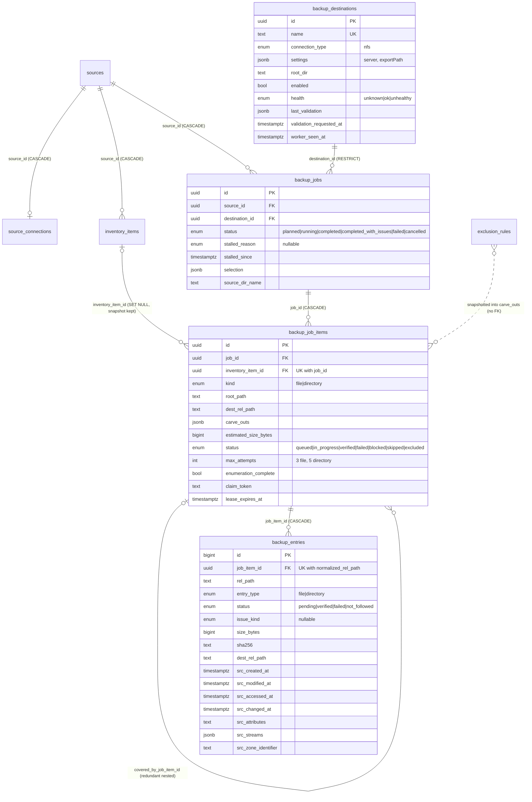

# Exodus Backup: Design for Copying Inventory to an NFS Destination

Status: **proposal, not built**, revision 4. Incorporates the answers to rounds 1, 3 and 4 in [questions-round-1-2.md](./questions-round-1-2.md), [questions-round-3.md](./questions-round-3.md) and [questions-round-4.md](./questions-round-4.md). The round 2 recommendations, never answered directly, were confirmed in round 4. Nothing is implemented. When work starts, this becomes `docs/exodus/backup.md`.

## Context

Exodus (`apps/homelab-api`, `packages/homelab-db`, docs in `docs/exodus/`) can discover a Windows source over SMB and produce human-approved **inventory items**. Nothing copies them yet. The goal is a one-time, auditable, interruption-safe migration of approved inventory from a retiring machine to an NFS export on the NAS. It gives per-item outcomes, keeps rich metadata about every copied file in Postgres, and ends with a coverage report that can honestly say "everything eligible is accounted for", or name exactly what isn't.

## 0. Decisions made

| #            | Decision                                                                                                                                                                                                                                                                                                              | Effect on the design                                                                                                                                                        |
| ------------ | --------------------------------------------------------------------------------------------------------------------------------------------------------------------------------------------------------------------------------------------------------------------------------------------------------------------- | --------------------------------------------------------------------------------------------------------------------------------------------------------------------------- |
| Q1           | New `apps/backup-worker`, like `video-worker`                                                                                                                                                                                                                                                                         | Source-access code is extracted into a shared package first (§1.1, M0).                                                                                                     |
| Q2           | Kernel NFS mount; the worker gets the destination path from an environment variable                                                                                                                                                                                                                                   | `BACKUP_DESTINATION_PATH`; the DB holds only the expected `server:exportPath` (§3.1).                                                                                       |
| Q3           | Backup jobs are human-only                                                                                                                                                                                                                                                                                            | No MCP tools.                                                                                                                                                               |
| Q4           | SHA-256 of the source stream vs a re-read of the destination after fsync                                                                                                                                                                                                                                              | Unchanged (§6).                                                                                                                                                             |
| Q5           | Keep both on a content conflict                                                                                                                                                                                                                                                                                       | The existing destination file is never touched; the new copy gets a suffixed name (§7).                                                                                     |
| Q6           | Source changing mid-copy: not handled                                                                                                                                                                                                                                                                                 | No change detection. Truncation is still caught by the size check.                                                                                                          |
| 4b           | Retries                                                                                                                                                                                                                                                                                                               | **3 attempts for file items, 5 for directory items** (R3-6).                                                                                                                |
| Q7           | Undecided items block `allAccounted`                                                                                                                                                                                                                                                                                  | Unchanged (§6).                                                                                                                                                             |
| Q8           | Discovery review status is display only                                                                                                                                                                                                                                                                               | Unchanged (§6).                                                                                                                                                             |
| Q9           | Back up all inventory, files and directories                                                                                                                                                                                                                                                                          | Directory items are in the first slice.                                                                                                                                     |
| Q10          | No ownership needs; single NFS destination; destination mirrors the source structure                                                                                                                                                                                                                                  | Layout in §8.                                                                                                                                                               |
| R3-1         | k8s manifests live in `pbabbott/home-kubernetes` (Flux), namespace `home-hud`. Resource limits are tight. Local dev uses a sample directory through the environment variable. Production is the only remote environment.                                                                                              | A GitHub issue with suggested manifests (Appendix B). Conservative resource use (§5). Mount check can be turned off for local dev only (§3.1).                              |
| R3-2         | Unsure of the NAS filesystem: check `video-worker`'s mount                                                                                                                                                                                                                                                            | Done, see below. Validation also probes the filesystem (§3.1).                                                                                                              |
| R3-3         | Fast wired links, no deadline. **The Windows machine may go offline unexpectedly**                                                                                                                                                                                                                                    | Every step is idempotent and resumable; an unreachable source pauses the job (§5).                                                                                          |
| R3-4         | Sequential, with a parallelism environment variable                                                                                                                                                                                                                                                                   | `BACKUP_PARALLELISM`, default 1 (§5).                                                                                                                                       |
| R3-5         | Stall timeout                                                                                                                                                                                                                                                                                                         | `BACKUP_STALL_TIMEOUT_SECONDS`, default 120 (§5).                                                                                                                           |
| R3-6         | Release and refund on graceful shutdown; 5 attempts for directories                                                                                                                                                                                                                                                   | SIGTERM handling (§5).                                                                                                                                                      |
| R3-7         | Unreachable source pauses claims with `source_unreachable`; credentials are tested at source creation                                                                                                                                                                                                                 | Job-level `stalled_reason` (§3.2, §5).                                                                                                                                      |
| R3-8         | Free space is not a concern                                                                                                                                                                                                                                                                                           | No free-space floor. The plan shows the estimate; `ENOSPC` is still handled.                                                                                                |
| R3-9         | **Keep project metadata in the database. The destination is raw data and must not be polluted**                                                                                                                                                                                                                       | **No manifests, markers or reports on the NAS.** The manifest becomes a per-file table in Postgres (§3.4). This reverses the earlier "no per-file rows" lean, deliberately. |
| R3-10        | No sign-off step; JSON export of the coverage report                                                                                                                                                                                                                                                                  | Export in §10.                                                                                                                                                              |
| R3-11        | Rejected means final: "do not back up"                                                                                                                                                                                                                                                                                | Counted as intentionally accounted for. Listed under its own bucket on request, not prominently.                                                                            |
| R3-12        | **Minimal home-hud pages in the first release, including an ultra-simple "start backup job" button**                                                                                                                                                                                                                  | UI milestone (§10, M6).                                                                                                                                                     |
| R3-13        | No notifications                                                                                                                                                                                                                                                                                                      | None.                                                                                                                                                                       |
| R3-14        | **Keep as much metadata about the original files as possible in the DB, especially modified and creation times**                                                                                                                                                                                                      | Per-file metadata columns (§3.4). Modified time is also applied to the NAS file; creation time cannot be, so it lives in the DB only. Junk files are copied too (R4-4).     |
| R3-15        | Commit the docs. One branch and PR per milestone, started from `feat/exodus-refinement`                                                                                                                                                                                                                               | §13.                                                                                                                                                                        |
| R2-1 to R2-7 | All seven recommendations confirmed in R4-1: one worker per destination; validation requested through the DB and run by the worker; `<source>/C/…` layout and `name.exodus-<jobId8>.ext` keep-both names; worker holds `EXODUS_CREDENTIAL_KEY`; per-file `smbclient` acceptable if tolerable; hand-pick the first run | Applied throughout.                                                                                                                                                         |
| R4-1.1       | **A new shared package, `packages/source-access`, for the SMB code.** Schema, migrations and queries stay in `homelab-db`, as for every other table                                                                                                                                                                   | §1.1.                                                                                                                                                                       |
| R4-2         | **Destination is `192.168.4.124:/volume1/Dump`**, writable like the video worker's. It already holds unrelated files, so the source-name + drive-letter layout is what keeps Exodus's data apart                                                                                                                      | `root_dir` is optional and empty; a separate export means a new PV/PVC (§3.1, §8, Appendix B).                                                                              |
| R4-3         | All machines are in `America/Chicago`                                                                                                                                                                                                                                                                                 | **No time zone setting is needed**: SMB times are absolute instants (§0 probe findings).                                                                                    |
| R4-4         | Copy everything inside an approved directory ("a backup is a backup")                                                                                                                                                                                                                                                 | No junk filtering; discovery and inventory decide what is good.                                                                                                             |
| R4-5         | Record `Zone.Identifier` contents; do not record owner/ACL                                                                                                                                                                                                                                                            | `src_zone_identifier` on entries (§3.4).                                                                                                                                    |
| R4-6         | Probing the real source read-only is allowed                                                                                                                                                                                                                                                                          | Done once for the design (§0 probe findings); the M4 spike continues from it.                                                                                               |
| R4-7         | A discovery job and a backup job may run at the same time                                                                                                                                                                                                                                                             | Warning on the start confirmation if a discovery job is active.                                                                                                             |
| R4-8         | Keep `backup_*` names                                                                                                                                                                                                                                                                                                 | Unchanged.                                                                                                                                                                  |
| R4-9         | M3 includes Dockerfile, `abctl`, image publication and CI wiring, following `video-worker`                                                                                                                                                                                                                            | §13.                                                                                                                                                                        |
| R4-10        | The `home-kubernetes` issue will be implemented later by **another Claude session**                                                                                                                                                                                                                                   | Appendix B is rewritten to be self-contained; it is created at the start of M3.                                                                                             |
| R4-11        | A new **Backup** entry in the Exodus nav. Nothing special in the UI: focus on the backend API and database; get the domain right before the UI gets fancy                                                                                                                                                             | §10, §13 (UI last, minimal).                                                                                                                                                |
| R4-12        | `C:\backup-test\Brandchelor Party.zip` is fine as the first real item                                                                                                                                                                                                                                                 | §11.                                                                                                                                                                        |
| R4-13        | Start M0 now                                                                                                                                                                                                                                                                                                          | §13.                                                                                                                                                                        |

### What the dev database says (queried read-only on 2026-10-27)

- One source (`alpha-centauri`), 213 inventory items, all on `C:\`, none UNC, longest path 103 characters, none containing `;` or `"`.
- Approved: **76 files and 60 directories** (136 job items). Rejected: 55 files and 22 directories. **No pending items.**
- **No nested pairs**, so redundant-nested and carve-out logic exists for correctness but is not exercised by today's data.
- Size evidence exists for 152 of 213 items, about 2.4 GB for the approved ones that have it. The real total is unknown; you expect a few hundred GB, at most 1 TB.

### What the production NAS mount looks like (`kubectl`, `video-worker`, namespace `home-hud`, read-only)

- The mount is **NFS v4.2** from `192.168.4.124:/volume1/Media` (`/volume1` suggests a Synology), `rw`, `sec=sys`, `rsize=wsize=1 MiB`, `namlen=255`, and **`hard`**.
- The export has about 23 TB total and 18 TB free, so space is not a concern.
- The pod runs as uid/gid 1000; the directory is mode `777`, owned by uid 999.
- The pod has requests of 100m CPU and 256Mi memory, and a 1Gi memory limit. The strategy is `RollingUpdate`, and the grace period is the default 30 s.
- The underlying filesystem type (btrfs or ext4) is not visible from the client. The validation probe (§3.1) will report case sensitivity, a 255-byte name, awkward characters and whether `utimes` works.
- **Root squash** means the NAS maps a client's root user (uid 0) to an anonymous user, so root on the client gets no special rights on the export. Our pod runs as uid 1000, not root, so it should not matter. The `utimes` check in validation would show if ownership prevents setting times.
- **`hard` matters.** On a hard mount, an unreachable NAS does not return errors. File calls **block indefinitely** and the process can stay stuck. The design therefore needs a destination I/O watchdog (§5, risk R5).

### The destination: `192.168.4.124:/volume1/Dump`

- It is a **different export from `Media`**, so it needs its own PV/PVC and its mount identity is distinct from the media library's.
- It **already holds unrelated files** (R4-2). Exodus writes only under `<source name>/…`, never touches anything else, and keep-both protects against a same-named file. The planner reports a warning if `<source name>/` already exists at the destination, because the new data would merge into it.
- The answer said "uid 100"; this is taken as uid 1000, like `video-worker`. The validation probe reports the effective uid and whether it can create files and set times, which will confirm it.

### What the source probe showed (read-only `smbclient` against `alpha-centauri`, 2026-10-28)

Allowed under R4-6. What ran: `allinfo` on one file and one directory, 20 `allinfo` commands in one session, one recursive `ls` of an 800-line tree, and `get` of one 14 KB approved file and of its `Zone.Identifier` stream into a scratch directory (deleted afterwards). Nothing was written to the source. Reading did touch the access time of the few paths involved (see the last bullet).

- **Times are absolute instants.** `allinfo` printed `create_time`, `access_time`, `write_time` and `change_time` as `... UTC`. With `TZ=America/Chicago` the very same instants printed as `CST`/`CDT`. SMB carries UTC; `smbclient` only formats them in the client's `TZ`. So **the source's time zone does not matter** (R4-3): the worker runs every `smbclient` child with `TZ=UTC` and parses UTC. Corollary for existing data: the discovery `DirEntry.modifiedAt` strings are UTC wall-clock times, because the API passes no `TZ` to its children.
- **Cost.** A single `smbclient` call costs about 50 to 200 ms (process start and SMB session). Twenty `allinfo` commands in one session took 498 ms, about 25 ms each. A recursive `ls` of a tree of about 800 lines took 1.1 s in one call. So the cost to avoid is process-per-file, and batching works. Large-file throughput is still unmeasured (M4).
- **What `ls` gives:** names, attribute flags, size and write time to the second. Creation, access and change times, the 8.3 name and the stream list need `allinfo`.
- **`allinfo` output** includes `attributes: A (20)` and one `stream: [name:$DATA], N bytes` line per stream, for example `stream: [:Zone.Identifier:$DATA], 26 bytes`.
- **`Zone.Identifier` content** is read with `get "path:Zone.Identifier" local` and was `[ZoneTransfer]` / `ZoneId=3`. (`allinfo "path:Zone.Identifier"` just reports the main file.)
- **Reading changes access times.** The probed file's `access_time` changed from 2021-03-14 to the time of the probe between two consecutive `allinfo` calls: merely inspecting a file moves it. So the metadata must be captured **once, before any other access**, and a retry must never overwrite it (§3.4, §7). The copy itself will move the access time of every file it reads on the source; that is unavoidable over SMB, and the database keeps the originals.

---

## 1. Existing architecture and what can be reused

| Concern                     | What exists                                                                                                                                                                                                                                                                                                                                                                                                                                                                                                                                                                                                                                         | Where                                                                                            |
| --------------------------- | --------------------------------------------------------------------------------------------------------------------------------------------------------------------------------------------------------------------------------------------------------------------------------------------------------------------------------------------------------------------------------------------------------------------------------------------------------------------------------------------------------------------------------------------------------------------------------------------------------------------------------------------------- | ------------------------------------------------------------------------------------------------ |
| Source                      | `sources` (name unique, `source_type: windows`, optional `host_id`)                                                                                                                                                                                                                                                                                                                                                                                                                                                                                                                                                                                 | `packages/homelab-db/src/schema/discovery.ts`                                                    |
| Source connection           | `source_connections`: **separate 1:1 table** keyed by `source_id`, with `connection_type` (`smb`), username/domain, `secret_ciphertext` (AES-256-GCM via `lib/secret-box.ts`, key `EXODUS_CREDENTIAL_KEY` read at use), `settings` (shareMappings), `last_test_*`. The password is never returned. Human-only REST.                                                                                                                                                                                                                                                                                                                                 | `apps/homelab-api/src/services/discovery/source-connections.ts`                                  |
| Driver abstraction          | `ConnectionDriver { test, stat, open (stream), readTail, list }`, registered by type in `DRIVERS`. The SMB driver spawns `smbclient` (password in env, never argv) and refuses paths containing `;` `"` or newlines (`assertSafeForCommand`). `resolveShare` maps a Windows path to a share. `ConnectionTarget` is built by a helper (around line 117 of `source-connections.ts`) that decrypts the password and reads the linked host. `DirEntry.modifiedAt` is a UTC wall-clock string without a zone marker (smbclient formats SMB's UTC times in the client's `TZ`, and the API passes none).                                                   | `apps/homelab-api/src/lib/connections/`                                                          |
| Inventory                   | `inventory_items`, unique `(source_id, normalized_root_path)`. `kind: file\|directory`. `root_path` is an **absolute Windows path** (`C:\…` or UNC). There are no source-relative paths. `normalized_root_path` is lowercased. The agent owns recommendation columns and a human owns `decision` (`pending\|approved\|rejected`). Nested items are allowed and only reported.                                                                                                                                                                                                                                                                       | schema + `queries/inventory-items.ts`                                                            |
| Copy rule (read-only today) | `path-coverage`: the nearest decided item at or above a path decides. A nested `rejected` item is a **carve-out**, and a nested `approved` item inside an approved one is **redundant**.                                                                                                                                                                                                                                                                                                                                                                                                                                                            | `services/discovery/path-coverage.ts` (`resolveCoverageStatus`)                                  |
| Exclusions                  | `exclusion_rules` (`exclude_subtree`, `selective_only`; global beats source). `resolveExclusion` exists. Approval is already refused under a rule.                                                                                                                                                                                                                                                                                                                                                                                                                                                                                                  | `queries/exclusion-rules.ts`                                                                     |
| Queue                       | `discovery_queue_items`, job-scoped. A claim is one transaction: lock the job row (`FOR NO KEY UPDATE`), then the item (`FOR UPDATE SKIP LOCKED`), returning a `claimToken`. Lease defaults to 5 min, extended by `heartbeat`. Expiry is **lazy** and spends an attempt. `release` refunds the attempt. `fail(retryable)` backs off exponentially from 30s, capped at 1h. Human `retry` grants exactly one more attempt and only works while the job is active. Repeated `complete` calls are idempotent via `settledByClaim`. `activeClaim` guards in the `WHERE` clause. A claim with nothing to give returns `200 {item:null, reason, retryAt}`. | `queries/discovery/claims.ts`, `queue-helpers.ts`, `queue-items.ts`; `docs/exodus/processing.md` |
| Job lifecycle               | `pending → running → completed\|failed\|cancelled`. At most one active job per source (partial unique index). Permanently failed items don't block completion. Cancel and fail release leases.                                                                                                                                                                                                                                                                                                                                                                                                                                                      | `discovery_jobs`                                                                                 |
| Audit                       | `audit_events` is append-only, with id columns that have **no FKs**. Events are written in the same transaction as the change, typed via `AuditEventType`. The actor comes from `X-Actor-Type/Id` (`human\|openclaw\|system`). Rejected requests write nothing.                                                                                                                                                                                                                                                                                                                                                                                     | `queries/audit.ts`                                                                               |
| Worker pattern              | `apps/video-worker`: `config.ts` (env), `db.ts`, `server.ts` (`/healthz`, `/readyz`), `process.ts`, `worker/poll-loop.ts`, claims via `FOR UPDATE SKIP LOCKED`, runs migrations at startup under an advisory lock, writes to a mounted NAS path guarded by `resolveWithinRoot` (`src/lib/safe-path.ts`).                                                                                                                                                                                                                                                                                                                                            | `apps/video-worker/src/`                                                                         |
| Frontend                    | home-hud pages under `apps/home-hud/src/app/exodus/`; server actions return results instead of throwing; all text uses `Typography` with no font or colour overrides; `fui-components` can't be imported from a Server Component.                                                                                                                                                                                                                                                                                                                                                                                                                   | `apps/home-hud`, `docs/exodus/ui.md`, `docs/exodus/decisions.md`                                 |
| Conventions                 | Derive counts rather than storing them (`getQueueCounts`). Keep `path` and `normalized_path` side by side. Use `first_*`/`last_*` provenance. CHECK constraints for state invariants. Lock the job row before item rows. Prove behaviour with integration tests against the real dev DB.                                                                                                                                                                                                                                                                                                                                                            | `docs/exodus/decisions.md`                                                                       |

### 1.1 Reuse: what moves into a shared package (consequence of Q1)

The SMB driver, `secret-box`, `windows-path` and the target-building helper live inside `apps/homelab-api`, so a separate worker app cannot import them. Extract them first as a behaviour-preserving refactor:

- New package `@abbottland/source-access` under `packages/source-access`: `connections/{types,smb,index}.ts`, `windows-path.ts`, `secret-box.ts`, and a pure `buildConnectionTarget(connection, host)` split out of the `source-connections.ts` helper. It takes already-loaded rows and does no DB access, so `homelab-db` is not a dependency. Schema, migrations and queries for the new tables stay in `homelab-db` (R4-1.1).
- `homelab-api` imports from the package, and its unit tests (`smb`, `windows-path`, `secret-box`, `paths`) move with the code.
- `backup-worker` loads the connection row via `homelab-db` and calls `buildConnectionTarget`.
- The worker image needs `smbclient` (`apk add samba-client`, as in the API image) and the `EXODUS_CREDENTIAL_KEY` secret.

**Reused as-is after extraction:** sources, `source_connections` and the SMB driver (`open`, `stat`, `list`), the secret box, inventory decisions, `resolveExclusion`, `resolveCoverageStatus` semantics, the lease/claim/retry _pattern_ (copied as new tables, not shared), audit, `resolveWithinRoot` (copied with a symlink check).

**Not reused:** the discovery queue table itself. Copy work has different payloads, outcomes and retry semantics, and conflating the two would break `queueCounts` and the job-owns-lifecycle rule.

---

## 2. Goals and non-goals

**Goals**

- Copy approved inventory (files and directories) from one source to one NFS destination per job, with a frozen scope.
- Use an item-level outcome that is separate from job-level completion.
- Verify by content hash, so "covered" means verified bytes at that destination.
- **Be idempotent and resumable.** The Windows machine may disappear at any time, as may the worker pod. Any interruption followed by a rerun ends with the same destination tree and no duplicated or overwritten data.
- Record, for every copied file and directory, the source metadata (all timestamps, attributes, alternate stream names) and the verification result in Postgres.
- Report coverage per (source, destination) that accounts for every inventory item, and claim completeness only when its definition is met.
- Mirror the source's folder structure on the NAS so the destination is a clean, raw directory for later processing.

**Non-goals:** continuous sync, schedules, incremental or change detection, handling files that change mid-copy, retention, deletion propagation, restore or re-verify tooling, ownership/ACL/ADS content preservation, VSS snapshots, a second destination type, multi-destination fan-out in one job, redesigning discovery, MCP tools, notifications, a source sign-off step, and manifests, markers or reports on the NAS.

---

## 3. Entities

### 3.1 `backup_destinations` (new)

One table with a typed `settings` jsonb, not a separate connection table. Reasoning: `source_connections` is separate because a source exists without file access (discovery is agent-driven). A destination has no meaning without its connection. NFS (AUTH_SYS) needs no secret, so there is nothing to isolate. A later type needing credentials adds a nullable `secret_ciphertext`, as in `source_connections`.

| Field                                                                                | Notes                                                                                                                                                                                             |
| ------------------------------------------------------------------------------------ | ------------------------------------------------------------------------------------------------------------------------------------------------------------------------------------------------- |
| `id` uuid PK, `name` text UK                                                         | display name                                                                                                                                                                                      |
| `connection_type` enum `backup_destination_type`                                     | `nfs` only                                                                                                                                                                                        |
| `settings` jsonb                                                                     | NFS: `{ server, exportPath }`, the _expected_ identity of the mount (`192.168.4.124` and `/volume1/Dump`). Where it is mounted comes from the worker's environment.                               |
| `root_dir` text nullable                                                             | optional path relative to the mount where Exodus writes. **Empty means the mount root**, which is the case for `/volume1/Dump`: the layout is `<mount>/<source name>/C/…`. No `..`, not absolute. |
| `enabled` boolean                                                                    | disabled ⇒ no new jobs, and claims for its jobs return `destination_disabled`                                                                                                                     |
| `health` enum `unknown\|ok\|unhealthy`, `last_validated_at`, `last_validation` jsonb | written by the worker. `last_validation` holds the checks and the probe findings (mount type and options, case sensitivity, max name length, `utimes` support).                                   |
| `validation_requested_at` timestamptz nullable                                       | set by the API's validate route, cleared by the worker                                                                                                                                            |
| `worker_seen_at` timestamptz nullable                                                | the worker's last poll, so the UI can say "no worker is running for this destination"                                                                                                             |
| `created_at`, `updated_at`                                                           |                                                                                                                                                                                                   |

**One worker deployment per destination.** The worker is configured with `BACKUP_DESTINATION_ID` and `BACKUP_DESTINATION_PATH` (the container path of the mounted export), like `MEDIA_ROOT` in `video-worker`. It claims only jobs for its destination.

Invariants:

- `server`, `exportPath` and `root_dir` cannot be edited while the destination has an active job, or after any job item is verified at it. Changing where the data goes would silently invalidate coverage, so a move means a new destination.
- A disabled destination can still be read in reports.

**Validation.** The API cannot see the NFS mount, so `POST /backup-destinations/:id/validate` sets `validation_requested_at` and returns 202. The worker's poll loop picks it up (and also validates at startup), runs the checks, and writes `health` and `last_validation`. It passes only if **all** of these hold:

1. **Mount identity.** `BACKUP_DESTINATION_PATH` is a mount point whose `/proc/mounts` entry is an NFS filesystem of `server:exportPath`. This is the key safety check: an unmounted directory would otherwise silently write into the container filesystem. For **local development only**, `BACKUP_DESTINATION_MOUNT_CHECK=none` skips this check against a sample directory; the result records `mountVerified: false`, which the UI shows. Production sets `nfs` (the default).
2. `<mount>/<root_dir>` (the mount root when `root_dir` is empty) exists or can be created, and no component of it is a symlink.
3. A transient probe directory, `<root>/.exodus-probe-<random>/` (a hidden folder at the root of the export, even a shared one like `Dump`), proves write semantics: write, `fsync`, read back and match a hash, `link()` (no-clobber, §7), rename, `utimes`, a 255-byte name, a case-variant pair, awkward characters (spaces, trailing dots, non-ASCII). The directory is **removed afterwards**; success leaves nothing behind, and what the probe found is reported.
4. Free space (`statfs`) and the effective uid/gid are reported. Free space is information only (R3-8).

**No markers on the NAS (R3-9).** Mount identity (check 1) replaces the destination marker. The "this root belongs to another destination" guard is not needed because the destination is defined by the verified mount plus `root_dir`.

### 3.2 `backup_jobs` (new)

| Field                                                                 | Notes                                                                                                                                                                 |
| --------------------------------------------------------------------- | --------------------------------------------------------------------------------------------------------------------------------------------------------------------- |
| `id`, `source_id` FK (CASCADE), `destination_id` FK (RESTRICT)        |                                                                                                                                                                       |
| `status` enum                                                         | `planned → running → completed \| completed_with_issues \| failed \| cancelled`                                                                                       |
| `stalled_reason` enum nullable, `stalled_since` timestamptz           | `destination_unhealthy`, `destination_disabled`, `source_unreachable`. Set by the worker while claims are paused, cleared on resume. The status stays `running` (§5). |
| `selection` jsonb                                                     | the criteria as requested (`{ inventoryItemIds?, pathPrefix?, kinds?, skipAlreadyCovered }`), kept for audit                                                          |
| `source_dir_name` text                                                | the destination folder for this source (§8), frozen at creation                                                                                                       |
| `error` text nullable                                                 | failure or cancel reason                                                                                                                                              |
| `created_at`, `started_at`, `finished_at`, `updated_at`, `created_by` |                                                                                                                                                                       |

Invariants:

- A partial unique index allows **one active (planned/running) job per (source, destination)**, so two jobs never write the same tree.
- The scope is frozen at creation: job items are inserted in the same transaction as the job and no route ever adds items later. Newly discovered or newly approved inventory needs a new job.
- Counts are **derived** from job items and entries (like `getQueueCounts`), not stored.

**Final outcome**, computed at completion once no item is `queued` or `in_progress`:

- `completed`: every item is `verified`, `skipped` or `excluded`.
- `completed_with_issues`: at least one item is `failed` or `blocked`.
- `failed`: a human marked it failed (the run is broken). Item outcomes stay as recorded.
- `cancelled`: a human cancelled it. Leases are released, and `queued` items stay `queued` as the record of what never ran.

`completed` never implies coverage of the source. That is the coverage report's job (§6).

### 3.3 `backup_job_items` (new): selection, work unit and result in one row

One row per inventory item in the job. It carries the snapshot, the lease and the outcome. This mirrors `discovery_queue_items`, where the work row _is_ the unit of record.

| Group    | Fields                                                                                                                                                                                                                                                                                                |
| -------- | ----------------------------------------------------------------------------------------------------------------------------------------------------------------------------------------------------------------------------------------------------------------------------------------------------- |
| Identity | `id`, `job_id` FK CASCADE, `inventory_item_id` FK SET NULL, UK `(job_id, inventory_item_id)`                                                                                                                                                                                                          |
| Snapshot | `kind`, `root_path`, `normalized_root_path`, `dest_rel_path` (relative to the destination root), `carve_outs` jsonb `[{ path, reason: 'rejected_item'\|'exclusion_rule', refId }]`, `covered_by_job_item_id` (for redundant nested items), `estimated_size_bytes` (from inventory evidence, nullable) |
| State    | `status` enum `queued\|in_progress\|verified\|failed\|blocked\|skipped\|excluded`, `status_reason` text (e.g. `already_covered`, `redundant_nested`, `excluded_by_rule`, `source_missing`)                                                                                                            |
| Lease    | `attempt_count`, `max_attempts` (**3 for files, 5 for directories**), `available_at`, `claimed_by`, `last_claimed_by`, `claim_token`, `lease_expires_at`, `last_error`                                                                                                                                |
| Progress | `enumeration_complete` boolean, `enumerated_at`, `started_at`, `completed_at`. Entry counts and bytes are **derived** from `backup_entries`.                                                                                                                                                          |

CHECKs: `0 ≤ attempt_count ≤ max_attempts`. `in_progress ⇒` all claim fields are set. `verified ⇒ completed_at` is set and `enumeration_complete` is true.

Why rows rather than an embedded list:

- **Pro:** per-item status, leases, indexes and coverage queries, the FK to inventory, and the same proven claim pattern.
- **Con:** one more table. An embedded list cannot be claimed per item or queried for coverage without unnesting, so it fails the core requirements.

### 3.4 `backup_entries` (new): one row per file or directory copied, with its metadata

This replaces the earlier on-NAS JSONL manifest and the issues table (R3-9, R3-14). Each filesystem object an item covers has one row: the file for a file item, every file and directory beneath a directory item (the item root itself has `rel_path = ''`).

**Why a per-file table is justified now.** The original brief said to avoid a permanent record per copied file "unless there is a clear need". There is one: you want the source metadata of old files kept in the database, you want the destination to stay raw, and a completeness claim for a directory needs a verified list of what was copied. One table serves all three. Scale is modest: even a million files at a few hundred bytes each is a few hundred MB of Postgres, inserted in batches.

| Field                                                                    | Notes                                                                                                                                                                                                                                                                                                                                                                                                                     |
| ------------------------------------------------------------------------ | ------------------------------------------------------------------------------------------------------------------------------------------------------------------------------------------------------------------------------------------------------------------------------------------------------------------------------------------------------------------------------------------------------------------------- |
| `id` bigint identity, `job_item_id` FK CASCADE                           |                                                                                                                                                                                                                                                                                                                                                                                                                           |
| `rel_path`, `normalized_rel_path`                                        | relative to the item's root, display spelling next to lowercase; **UK `(job_item_id, normalized_rel_path)`**                                                                                                                                                                                                                                                                                                              |
| `entry_type` enum                                                        | `file`, `directory`                                                                                                                                                                                                                                                                                                                                                                                                       |
| `status` enum                                                            | `pending` (enumerated, not yet verified), `verified`, `failed`, `not_followed` (junction or other special object)                                                                                                                                                                                                                                                                                                         |
| `issue_kind` enum nullable, `message`                                    | for `failed`: `read_failed` (includes a stream shorter than the file's size), `unlistable`, `source_missing`, `name_too_long`, `unsupported_path` (smbclient `;`/`"`, or a computed path that escapes the root or crosses a symlink), `verify_mismatch`, `write_failed`, `dest_conflict`. For `not_followed`: `reparse_point_not_followed`. For a `verified` entry that was kept alongside an existing file: `kept_both`. |
| `size_bytes`, `sha256`                                                   | hash of the source stream, equal to the destination hash for `verified` files                                                                                                                                                                                                                                                                                                                                             |
| `dest_rel_path`                                                          | the final destination path actually written, including any keep-both suffix; null until written                                                                                                                                                                                                                                                                                                                           |
| `src_created_at`, `src_modified_at`, `src_accessed_at`, `src_changed_at` | the source timestamps as absolute instants (`timestamptz`), parsed from `smbclient` run with `TZ=UTC` (§0 probe findings)                                                                                                                                                                                                                                                                                                 |
| `src_attributes` text                                                    | Windows attribute flags as reported (for example `AHS` for archive, hidden, system)                                                                                                                                                                                                                                                                                                                                       |
| `src_streams` jsonb nullable                                             | names and sizes of alternate data streams, **recorded but not copied**                                                                                                                                                                                                                                                                                                                                                    |
| `src_zone_identifier` text nullable                                      | the contents of the `Zone.Identifier` stream (Mark-of-the-Web: zone id, and the download URL and referrer when present), capped at 4 KiB, recorded when the stream exists (R4-5). Owner and ACL are **not** recorded.                                                                                                                                                                                                     |
| `attempt` int, `verified_at`, `created_at`, `updated_at`                 | `attempt` is the attempt that last touched the row                                                                                                                                                                                                                                                                                                                                                                        |

CHECKs: `verified ⇒ verified_at` is set, and for a file also `sha256` and `dest_rel_path` are set. `status = failed ⇒ issue_kind` is set.

How it is used:

- **Enumeration** inserts the item's entries as `pending` (batched, upsert on the unique key), then sets `enumeration_complete`. A retry re-enumerates and upserts, so it never duplicates.
- **Resume** is "process the `pending` and `failed` entries". An entry whose destination file still exists with the recorded size is trusted and skipped; one whose destination file is missing or has a different size is made `pending` again.
- **Completeness:** a job item is `verified` only when `enumeration_complete` is true and no entry is `pending` or `failed`. The enumerated entry list is the proof of what "all of the directory" meant at that time.
- **Coverage of a redundant nested item** is a lookup for a `verified` entry at the nested path in the parent item's entries.
- **Non-blocking notes** (`kept_both`, `not_followed`) are queryable for the report. Blocking outcomes (`failed`) drive item status (§5).
- **Metadata is captured once.** The `src_*` columns are written the first time an entry's metadata is read, before any other access to the file, and **never overwritten** by a retry or a later attempt (reading a file changes its access time on the source, so a second capture would record the wrong value).

### 3.5 Coverage is derived, not stored

Dedicated coverage rows are rejected for the MVP. A derived query over job items is the single source of truth, so it cannot disagree with history:

> **Inventory item I is covered at destination D** ⇔ some `backup_job_items` row with `inventory_item_id = I`, status `verified`, in a job targeting D, exists. Or I is a redundant nested item whose `covered_by_job_item_id` is verified _and_ has a verified entry for I's path.

Earlier verified data is never deleted or overwritten, so a later failed job does not revoke coverage. The report shows the latest attempt alongside, so a newer failure is still visible. Volume is hundreds of items, so a derived query with an index on `(inventory_item_id, status)` plus a join on `job.destination_id` is trivially cheap.

**Historical attempts:** within a job, `attempt_count` and `last_error` are kept, entries carry the attempt that last touched them, and each failed or expired attempt writes a `backup_job_item.attempt_failed` audit event. Across jobs, each job's item row is the history. No separate attempts table is needed.

### 3.6 Audit columns

Add nullable, no-FK columns `destination_id`, `backup_job_id` and `backup_job_item_id` to `audit_events`, rather than overloading the discovery `job_id`.

---

## 4. Relationships



Cardinalities:

- A source has 0..n backup jobs, and a destination has 0..n.
- A job has 1..n items (a job with no eligible items is rejected at creation).
- An inventory item has 0..n job items across jobs, and at most one per job.
- A job item has 1..n entries once enumerated (a file item has exactly one, with `rel_path = ''`).

---

## 5. Job and worker lifecycle

**Planning** (`POST /sources/:id/backup-jobs/plan`, a dry run, and `POST /sources/:id/backup-jobs`, the same logic plus a transactional insert; both run in the API):

1. Candidates are inventory items of the source matching `selection` (default: all).
2. Each candidate gets a status:
   - `decision ≠ approved` → not included. The plan response lists them as `notEligible` with a reason.
   - Covered by `exclude_subtree` per `resolveExclusion` → `excluded` (`excluded_by_rule`).
   - Nested inside another approved candidate in this job → `skipped` (`redundant_nested`), with `covered_by_job_item_id` set.
   - `skipAlreadyCovered` (default true) and already covered at D → `skipped` (`already_covered`).
   - Otherwise → `queued`, with `max_attempts` 3 (file) or 5 (directory).
3. For each queued directory item, `carve_outs` collects the nested `rejected` inventory items and the nested `exclude_subtree` rules.
4. `dest_rel_path` is computed (§8), and the plan reports the summed `estimated_size_bytes` and how many items have no estimate.
5. The job and its items are inserted in one transaction, with the `backup_job.created` audit event.

**Execution (the worker).** Modelled on `video-worker`: one process, an Express server for `/healthz` and `/readyz`, and a poll loop.

1. `start` moves `planned → running`. The first claim also starts it, as in discovery.
2. Each iteration: update `worker_seen_at`, handle a pending `validation_requested_at`, then pre-flight checks:
   - **Destination:** a quick mount-identity and probe check. On failure the destination goes `unhealthy`, the job's `stalled_reason` becomes `destination_unhealthy`, and claims answer `{item:null, reason:'destination_unhealthy', retryAt}`. No attempts are spent.
   - **Source:** a cheap `driver.test`. If the machine is off or SMB fails, `stalled_reason` becomes `source_unreachable`, no attempts are spent, and the worker backs off and retries until the test passes (R3-7). Bad credentials are not given special treatment; they are tested when a source is created.
   - On recovery `stalled_reason` is cleared and a `backup_job.resumed` event is written.
3. Claim one job item of this worker's destination: one transaction, lock the job row, expire leases, `FOR UPDATE SKIP LOCKED`.
4. Process the item (§7). Files run **sequentially** by default. `BACKUP_PARALLELISM` (default 1) sets how many files of one item move at once, so speed can be raised later without a code change.
5. **Heartbeats** every `BACKUP_HEARTBEAT_SECONDS` (60) with a lease of `BACKUP_LEASE_SECONDS` (300). Hours-long directory items depend on this.
6. `complete(claimToken)`: the item is `verified` if enumeration is complete and no entry is `pending` or `failed`. Otherwise:
   - every failed entry is transient (`read_failed`, `write_failed`, `verify_mismatch`) and attempts remain → `queued` with backoff (30s doubling, capped at 1h);
   - any non-transient entry (`source_missing`, `name_too_long`, `unsupported_path`, `dest_conflict`, `unlistable`) → `blocked`;
   - attempts exhausted → `failed`.
7. When the claim reports `queue_empty`, the worker calls the job completion check, which sets the final status (§3.2).

**Stalls and watchdogs.**

- **Source stall (R3-5):** if no bytes arrive from the source for `BACKUP_STALL_TIMEOUT_SECONDS` (default 120), the transfer is killed and the entry is a transient `read_failed`. A repeating stall that is really the machine going away is caught by the source pre-flight, which pauses instead of burning attempts.
- **Destination stall (risk R5):** the NAS mount is `hard`, so an outage hangs file calls instead of failing them. Each destination operation runs under a watchdog. If one has made no progress for the stall timeout, the worker **stops heartbeating**, marks the destination unhealthy, and fails its `/readyz` (and, for the Kubernetes liveness probe, its `/healthz` after a longer grace) so the pod is restarted. The lease then expires and the item is requeued. Without this the heartbeat timer would keep a hung item leased forever.
- **Graceful shutdown (R3-6):** on `SIGTERM` the worker stops claiming, aborts the in-flight transfer, deletes its staging file, and **releases** the item with the attempt refunded. Entries already `verified` stay verified. A hard crash still spends one attempt, as in discovery, and resume from `backup_entries` makes the next attempt cheap. The Deployment should set `terminationGracePeriodSeconds` to at least 60.

**Resource discipline** (limits are tight, R3-1): stream every file with bounded buffers (never read a file into memory), hash incrementally, run at most `BACKUP_PARALLELISM` `smbclient` children, insert entries in batches of a few hundred to a thousand and never hold a whole directory listing in memory, and page any entry queries. A conservative starting point for the Deployment is in Appendix B.

The worker writes through `homelab-db` queries directly (the `video-worker` model), so there are no worker-only HTTP routes. Claim, heartbeat, complete, fail, release and the entry upserts live in `packages/homelab-db/src/queries/backup/`, where both apps and the integration tests can use them.

**Idempotency:** `complete` repeated with the same token answers from the settled row (the `settledByClaim` pattern). A late worker after cancel or expiry is rejected because `activeClaim` includes the job-active guard. The central guarantee: **killing the worker or switching off the source at any instant and rerunning yields the same destination tree**, with nothing overwritten or duplicated (§7, §12).

---

## 6. Coverage and verification semantics

### Progression of one item

| Stage          | Meaning                                                                       | Recorded as                                    |
| -------------- | ----------------------------------------------------------------------------- | ---------------------------------------------- |
| Selected       | job item exists with `queued`                                                 | job item row                                   |
| Copy attempted | claimed (`attempt_count` ≥ 1)                                                 | lease fields + audit on failure                |
| Copy completed | every enumerated entry written and linked into place                          | entries with `dest_rel_path`                   |
| Verified       | each destination file re-read, SHA-256 equals the source stream's, size equal | entry `status = verified`; job item `verified` |
| Covered        | derived (§3.5) for (item, destination)                                        | coverage query                                 |

### Verification standard

- **Content SHA-256 for every file.** The source hash is computed while streaming from SMB (a `tee` into the staging file). This is free, because the bytes are read anyway. The destination hash comes from re-reading the file after `fsync`.
- **The streamed byte count must equal the `stat` size.** `smbclient` can end a stream early without an error (see the `open` doc comment in `lib/connections/types.ts`), and the hash of a truncated stream would still match the truncated destination. A short stream is a `read_failed`.
- Size and mtime alone don't detect corruption. Existence alone is worthless.
- Cost: one extra read of each destination file over NFS. For up to 1 TB on wired gigabit that roughly doubles the I/O time, which is acceptable for a one-time migration with no deadline.
- Caveat: the NFS client may serve the re-read from page cache. `fsync` guarantees an NFS COMMIT to the server, so the remaining risk is server-side corruption after commit, which is out of scope.
- **Timestamps and attributes:** the source's creation, modified, accessed and changed times (absolute instants, from `smbclient` run with `TZ=UTC`), attributes, alternate-stream names and the `Zone.Identifier` contents are recorded on the entry (§3.4) the first time the file is looked at. **Only the modified time is applied** to the NAS file, with `utimes` (files right after writing; directories bottom-up at the end of the item, because writing children changes a directory's time). Creation time cannot be set through NFS, so the database is its only home. Ownership and permissions are not preserved; files take the worker's uid and umask.

### Directory items and the entry table

- Selecting a directory copies **all descendants**, recursively, minus `carve_outs`. Reparse points (junctions/symlinks) are not followed and become `not_followed` entries.
- The worker enumerates via the SMB driver. How to enumerate and transfer efficiently, and how to obtain creation times cheaply, is the spike in risk R1.
- **Descendant errors:** any `failed` entry keeps the parent from `verified`. Verified entries stay on the destination, and the next attempt skips them when the destination file still exists with the recorded size.

### Guarantees that cannot be made

1. **Completeness of what SMB shows.** Files hidden from the SMB account (permission filtering, Access-Based Enumeration) are invisible, so enumeration cannot prove they don't exist. Unlistable subdirectories become failed `unlistable` entries, but entirely hidden entries cannot be detected.
2. **Discovery completeness.** Coverage covers _inventory_, not the disk. Whether inventory covers everything valuable is the existing review workflow's job. The report shows the discovery review status beside coverage (Q8) and does not redefine it.
3. **Consistency of files that change during the copy.** By your decision (Q6) this is out of scope. A truncated or corrupted transfer is caught by the size and hash checks; a _consistently modified_ file is not.
4. **Windows metadata fidelity.** ACLs and alternate stream _contents_ are not preserved. Attributes, streams' names and all four timestamps are recorded in the DB but only the modified time is applied to the file.
5. **Paths smbclient can't address** (containing `;` or `"`) are reported as `unsupported_path` and blocked. The current inventory has none.
6. **A kept-both copy is verified but is not at the "original name".** The item is covered, and the report flags it (§7).
7. **The copy changes the source's last-access times.** Reading a file over SMB moves its access time (observed in the probe), and nothing can prevent that. The originals are captured in the database before the first read. Creation, modification and change times are not affected by reads.

### Coverage report (`GET /sources/:id/backup-coverage?destinationId=`)

Every inventory item of the source lands in exactly one bucket:

| Bucket               | Rule                                                                            | Counts against "all accounted"? |
| -------------------- | ------------------------------------------------------------------------------- | ------------------------------- |
| `covered`            | §3.5                                                                            | no                              |
| `redundant_covered`  | nested approved item inside a covered ancestor that has a verified entry for it | no                              |
| `excluded_rule`      | approved but under `exclude_subtree` (or `selective_only`)                      | no, intentional                 |
| `rejected`           | human decision `rejected` (final: "do not back up", R3-11)                      | no, intentional                 |
| `undecided`          | decision `pending`                                                              | **yes** (Q7)                    |
| `pending`            | eligible, in an active job, not terminal                                        | **yes**                         |
| `failed` / `blocked` | latest job item for D is failed/blocked, never verified at D                    | **yes**                         |
| `never_attempted`    | eligible, no job item ever at D                                                 | **yes**                         |

`allAccounted = true` ⇔ there are no items in the four "yes" buckets. The response states the claim's scope: "_inventory items_, with per-file verification for directory items, subject to the stated limits". Rejected items are counted, and listed on request with `bucket=rejected` rather than prominently.

Alongside the buckets, the response carries **display-only** information (Q8): the discovery review status for the source (counts of directories whose skips and on-disk contents are still unreviewed), the number of kept-both files per covered item, and the non-blocking `not_followed` notes. None of these change `allAccounted`.

**Export (R3-10):** the same report is downloadable as JSON (`format=json` with a download header), so you can keep a record when you retire the machine.

---

## 7. Copy semantics per file (worker)

Everything here is safe to interrupt and repeat.

1. **Capture metadata first.** Before reading the file, look it up with `allinfo` (batched with its neighbours in one `smbclient` session) for size, the four times, attributes and the stream list; if a `Zone.Identifier` stream is listed, `get` it (small, capped). Write these to the entry only if they are not already recorded (first capture wins). If the file is missing, the entry is a `source_missing` failure. For a file item or the directory root itself that is a **discrepancy**: the item becomes `blocked`, never `verified`.
2. Resolve the destination path (§8) and check the root boundary.
3. **Skip if already done.** If the entry is `verified`, its `dest_rel_path` exists as a regular file, and its size equals the recorded size, there is nothing to do.
4. **Conflict handling (keep both).** If the destination final path exists as a regular file:
   - Its size and SHA-256 equal the source's → **adopt** it (the copy is already there) and mark the entry verified.
   - Otherwise → keep both: the destination file is **never touched** and the new copy goes to `<stem>.exodus-<jobId first 8>.<ext>` in the same directory. Mark the entry `kept_both`. Apply steps 5 to 8 to the suffixed name. If that name also exists with identical content → adopt. If it exists with different content → `dest_conflict` (blocking, the rare case).
   - A **directory** where a file must go, or a **file** where a directory must be created → `dest_conflict` (blocking). Keep-both can't resolve a type clash without inventing new directory names.
5. **Stream to a staging file.** Stream the source into `<root>/.exodus-staging/<jobItemId>/<entryId>`, hashing as it goes, then `fsync`. The staging directory is on the same export, so the later `link` is atomic, and **the copied tree never contains partial files**. If the streamed byte count differs from the `stat` size → `read_failed`, delete the staging file.
6. **Place without clobbering.** `link(staging, final)` fails with `EEXIST` instead of overwriting (validated in §3.1 check 3). On `EEXIST` re-enter step 4. Then `unlink(staging)` and `utimes(final, srcModified)`.
7. **Verify.** Re-read the destination, hash it, compare to the source hash. On a mismatch → `verify_mismatch`: delete _only the file this attempt created_, then retry or record the failure.
8. **Record.** Update the entry (`verified`, hash, size, `dest_rel_path`, `verified_at`).

After an item finishes, set directory times bottom-up and remove the item's (now empty) staging directory; remove `.exodus-staging` itself when empty. Leftover staging files from a crash are deleted at the start of the next attempt of the same item (they can only belong to that item), so the only things that ever exist on the NAS besides copied data are transient staging and probe directories.

Why keep-both rather than block (Q5): the destination is a raw directory for later processing, so a conflict should never stall the migration. The cost is duplicates, which the report counts and the entry table identifies, so you can find them.

---

## 8. Destination layout and safety

The copied tree mirrors the source structure and holds **only copied data** (plus keep-both files). There are **no marker, manifest or report files** (R3-9); all bookkeeping is in Postgres. The only other paths that ever exist are the transient `.exodus-staging/` and `.exodus-probe-*/` directories, which are removed when empty or after use.

```
<BACKUP_DESTINATION_PATH>/[<root_dir>/]          the mount root for /volume1/Dump (root_dir empty)
  alpha-centauri/                          one folder per source (source_dir_name)
    C/Users/Me/Pictures/Family/...         drive letter as a folder, no colon
    UNC/<server>/<share>/...               for UNC inventory paths
  .exodus-staging/                         only while a copy is in flight
```

- **`source_dir_name`** is a slug of the source name (`alpha-centauri`), chosen at the first job for (source, destination) and **reused** from the latest prior job afterwards, so renaming a source doesn't fork the tree. The planner refuses (409) a name already used by another source at this destination, according to the database. The source folder keeps different sources from colliding. The export is shared with unrelated files (R4-2): Exodus only ever creates and writes inside `<source_dir_name>/`. If that folder already exists at the destination when the first job is planned, the plan shows a warning, because the new data would merge into it.
- **Mapping:** a pure function of `root_path` (display spelling), stored as `dest_rel_path` on the job item.
  - Each `\` becomes `/`, and the drive letter `C:` becomes `C`.
  - Descendants use the spelling the SMB listing returns.
  - The mapping is deterministic, so retries and later jobs land on the same paths.
- **Case:** Windows is case-insensitive and NFS is case-sensitive (to be confirmed by the validation probe).
  - Inventory paths are unique case-insensitively, so two items can't map to two case variants.
  - A different-case spelling of the same item in a later job (rediscovery overwrote `root_path`) would split the tree. The planner reuses the `dest_rel_path` of the item's latest verified job item at D when one exists.
  - Two descendants that differ only in case inside one directory (rare) are two different files on NFS; no collision.
- **Root boundary:** resolve with `path.posix`, reject `..`, absolute segments and NUL, and `lstat` every existing component under the root so symlinks are refused. A symlink planted on the NAS cannot redirect writes. This follows `resolveWithinRoot` in `apps/video-worker/src/lib/safe-path.ts`, plus the symlink check.
- **Names:** a component over 255 bytes (`namlen=255` on the mount) → `name_too_long` (blocked). A keep-both suffix counts toward that limit. Other restrictions will show in the probe's findings.
- **Special objects:**
  - reparse points (junctions/symlinks) → not followed, `not_followed` entry, listed in the report;
  - devices and other non-regular entries → same handling;
  - empty directories → created, recorded as entries.
- **Existing data:** never deleted or overwritten. A different-content file means keep-both (§7).
- **Deletion propagation:** none. Source deletions are never mirrored.
- **Junk files (R4-4):** everything inside an approved directory is copied, including `desktop.ini`, `Thumbs.db` and Office lock files. "A backup is a backup": discovery and inventory decide what is good, and the backup does not second-guess them. There is no pattern exclusion (listed as a gap in `operations.md`), and attributes such as hidden are recorded in the DB.
- **NFS failures** (with a `hard` mount, the first line is the one that actually occurs in an outage; the others occur on a soft or misconfigured mount):
  - a call that never returns → destination watchdog (§5);
  - `EIO`, `ESTALE`, `ENOTCONN` or the mount missing → release (refund the attempt), destination `unhealthy`, back off;
  - `ENOSPC` → same, plus an audit event;
  - `EACCES`/`EPERM` on the root → unhealthy;
  - `EACCES` under the root → `write_failed` entry.
  - Validation must pass again (or the next pre-flight must pass) before claims resume.

---

## 9. Eligibility and exclusions

- **Never inventoried** (discovery skipped or excluded it): not in inventory, so not in the backup coverage report. It is reported by the existing known-skips and path-coverage tools.
- **Inventoried but not eligible:** `rejected` (final and intentional), `pending` (undecided, counts as unaccounted), or approved but under a rule (`excluded_rule`, intentional; reachable if a rule was added after approval).
- **Eligible:** `approved`, and not excluded. These are pending, covered, failed/blocked, or never attempted.
- **Unsupported:** a type or path that can't be copied becomes a failed entry, so the item is `blocked`, never `covered`.

**No backup-specific exclusion model.** Inventory decisions and `exclusion_rules` already express "don't copy this", and a rejected nested item is already the carve-out mechanism. A second policy layer would create two answers to "why wasn't this copied". The planner snapshots rules into `carve_outs`, so a rule added mid-job doesn't change a running scope. The next job picks it up.

---

## 10. API, UI, audit

### REST (human only)

| Route                                                                    | Purpose                                                                                            |
| ------------------------------------------------------------------------ | -------------------------------------------------------------------------------------------------- |
| `POST/GET /backup-destinations`, `GET/PATCH /backup-destinations/:id`    | create, list, edit (identity fields are immutable per the §3.1 invariant)                          |
| `POST /backup-destinations/:id/{validate,enable,disable}`                | `validate` returns 202 and the worker does the work; poll `GET` for `health` and `last_validation` |
| `POST /sources/:id/backup-jobs/plan`                                     | dry run: per-status counts, notEligible list, carve-outs, destination paths, size estimate         |
| `POST /sources/:id/backup-jobs`                                          | create a job with a frozen scope (`planned`)                                                       |
| `GET /backup-jobs`, `GET /backup-jobs/:id`                               | jobs with derived counts and `stalledReason`                                                       |
| `POST /backup-jobs/:id/{start,cancel,fail}`                              | guarded transitions                                                                                |
| `GET /backup-jobs/:id/items?status=`, `GET /backup-job-items/:id`        | item-level results                                                                                 |
| `GET /backup-job-items/:id/entries?status=&issueKind=`                   | paged per-file results and metadata                                                                |
| `POST /backup-job-items/:id/retry`, `POST /backup-jobs/:id/retry-failed` | one more attempt each (active job only)                                                            |
| `POST /backup-jobs/:id/rerun-unresolved`                                 | new job from the failed and blocked items of a finished job                                        |
| `GET /sources/:id/backup-coverage?destinationId=&bucket=&format=json`    | coverage report, `allAccounted`, paged items; `format=json` downloads the full report              |

There are **no worker routes**: the worker uses the shared `homelab-db` queries (§5). There are **no MCP tools** (Q3). If OpenClaw ever needs read access, the natural first tools are read-only status and unresolved-item listings, deferred.

### home-hud (first release, R3-12 and R4-11, deliberately minimal)

Pages under `apps/home-hud/src/app/exodus/backup/`, following the existing Exodus pages' conventions (`Typography` for all text with no font or colour overrides, `fui-components` only from client components, server actions that return results instead of throwing):

- **Backup overview:** the destination (health, "no worker running" if `worker_seen_at` is stale, a Validate button) and a single **Start backup job** button. The button runs `plan`, shows the plan numbers in a confirmation (items to copy, excluded, not eligible, estimated size and items without an estimate), and on confirm creates and starts the job. With one source and one destination it needs no pickers.
- **Job detail:** status and `stalledReason`, derived progress (items by status, bytes verified, entries verified and failed, kept-both count), the item list with each item's status and last error, and Cancel. Failed and blocked items link to their entries.
- **Coverage:** the buckets, `allAccounted`, the display-only discovery status, and a **Download JSON** button.

Everything else (retry buttons, entry browsers, filters) comes after the first release and is available through the REST routes and `/docs` meanwhile.

The pages sit under a new **Backup** entry in the Exodus nav (`/exodus/backup`). You asked for nothing special in the UI: the backend API and the database are the priority, so the pages are built **last** (M6) and only to the extent above. Anything the UI does not show is reachable through the REST routes and `/docs`.

### Audit events (same transaction as the change)

- `backup_destination.created|updated|enabled|disabled|validated` (validation: pass/fail + failed checks and probe findings, actor `system` for the worker)
- `backup_job.created` (selection, counts by status, notEligible count)
- `backup_job.started|completed|completed_with_issues|cancelled|failed`
- `backup_job.stalled|resumed` (reason, on transition only)
- `backup_job_item.verified` (entries, bytes, kept-both count)
- `backup_job_item.attempt_failed` (attempt, error, entry failure counts)
- `backup_job_item.blocked|failed` (reason)
- `backup_job_item.retried` (human)
- `backup_job_items.lease_expired` (actor `system`, batched)
- `backup_destination.unhealthy` (errno or watchdog, on transition only)

Per-file events are never written; the `backup_entries` table covers files. Worker-originated events use actor type `system` with the worker's id.

---

## 11. Workflows and risks

**Initial backup.**

1. Mount the export into the worker Deployment (Appendix B), set `BACKUP_DESTINATION_ID` and `BACKUP_DESTINATION_PATH`, start the worker. Create the destination in the API and validate until `ok`.
2. Click **Start backup job** (or `plan` then create then start through the API), review the plan, confirm.
3. The worker claims, copies and verifies each item. You watch the job page.
4. The job ends `completed` or `completed_with_issues`.
5. The coverage page shows the buckets and `allAccounted`, and you can download the JSON report.

**First real run:** hand-pick one small file item and one small directory item first (through the API's `selection`), check the NAS tree and the coverage report, then run the full approved set (today 136 items).

**Retry.**

- Transient failures auto-retry with backoff, up to `max_attempts` (3 for files, 5 for directories).
- A human retries failed items while the job is active.
- After the job ends: fix the cause, then `rerun-unresolved` creates a new job containing only those items.
- Verified files from earlier attempts are skipped or adopted by hash, not re-copied.

**Source goes offline (R3-3).**

1. Reads fail or the pre-flight `test` fails. The item in flight is released with its attempt refunded, the job shows `source_unreachable`, and claims pause.
2. The worker keeps testing the source with backoff. When it answers, claims resume.
3. The next attempt re-enumerates, trusts verified entries whose destination files still match, and continues.

**Worker crash or pod restart.**

1. On `SIGTERM` the worker releases the item with a refund. On a hard crash the lease expires and the next claim or completion check requeues the item, spending one attempt.
2. The new attempt deletes any staging files of that item.
3. It re-enumerates and upserts entries, skipping those verified with a matching destination file.
4. A file written but not yet recorded is found by the destination-exists branch (§7 step 4) and adopted by hash.
5. Nothing is overwritten.

**Destination failure.**

1. A pre-flight failure, a watchdog trip or an in-copy errno marks the destination `unhealthy`. The current item is _released_ (attempt refunded), and claims answer `destination_unhealthy` with `retryAt`.
2. The job stays `running`, so no items are failed just because the NAS rebooted.
3. A human can fail or cancel the job. Once validation or the pre-flight passes, claims resume.

### Risks

- **R1: process-per-operation cost over `smbclient` (narrowed by the probe, §0).** The current driver spawns a process per `stat`, `open` or `list`; measured at 50 to 200 ms each, against about 25 ms per `allinfo` when 20 share a session, and about 1 s for a recursive listing of an 800-line tree. Planned approach: enumerate a directory item with one `recurse ON; ls` call; get metadata with `allinfo` batched in groups per session (the commands are `;`-separated, subject to `assertSafeForCommand`; if the number of result blocks does not match the batch, retry the batch one by one); stream each file with `get … -` through the hasher. The remaining spike (M4) measures large-file throughput, whether many tiny files need batched `get` or a tar stream, a safe batch size, and how `ls` flags reparse points. The choice may change the copy loop; it does not change the data model.
- **R2: hours-long work items.** One directory can run for hours at up to 1 TB total. Mitigations: 60s heartbeats, entry-based resume, refund on graceful release, 5 attempts for directories. If a single directory proves too large to retry from scratch comfortably, sub-dividing it into per-subdirectory work items is a compatible later change (job items would gain a parent).
- **R3: the credential key moves to another deployment.** The worker needs `EXODUS_CREDENTIAL_KEY` to decrypt source passwords (accepted).
- **R4: `smbclient` truncation.** Covered by the size check and hash (§6).
- **R5: `hard` NFS mount.** An NAS outage hangs file calls rather than failing them, and a hung process can stay in uninterruptible sleep. Mitigation: the destination watchdog stops heartbeats and fails the probes (§5), so the lease expires and the pod is restarted. Retests need a way to simulate a stalled mount (a test seam around the file operations).
- **R6: reading changes source access times.** Observed in the probe. The design captures metadata once before any read and never overwrites it (§3.4, §7); the copy itself will still move access times on the source, which cannot be avoided. (The earlier time-zone concern is closed: SMB times are absolute, §0.)
- **R7: database write volume for entries.** Up to a few hundred thousand to a million rows for a large run. Batched upserts, an index on `(job_item_id, status)` and paged reads keep this cheap; no per-row audit events.
- **R8: tight memory.** Node plus one or two `smbclient` children must fit a small limit (Appendix B). Streaming and batching rules in §5 apply; the memory limit should be validated in the first real run.

---

## 12. Acceptance criteria (Given/When/Then)

**Destinations and the worker**

- Given a worker whose `BACKUP_DESTINATION_PATH` is not an NFS mount of the destination's `server:exportPath` and `BACKUP_DESTINATION_MOUNT_CHECK=nfs`, when validated, then validation fails with check `mount`, `health=unhealthy`, and no file is written.
- Given `BACKUP_DESTINATION_MOUNT_CHECK=none` against a local sample directory, when validated, then the mount check is skipped, `mountVerified` is false in `last_validation`, and the remaining checks run.
- Given a writable mount, when validated, then the probe finds are recorded (case sensitivity, max name length, `utimes` support, mount options), `health=ok`, the probe directory is removed, **nothing is left under `<root_dir>`**, and `backup_destination.validated` is audited.
- Given `POST …/validate`, then the API returns 202, sets `validation_requested_at`, and the worker clears it after writing `last_validation`.
- Given no worker has polled recently, then the destination reads as having no live worker (`worker_seen_at` stale).
- Given a destination with a verified job item, when `PATCH` changes `server`, `exportPath` or `root_dir`, then 409.
- Given a disabled destination, when a job is created for it, then 409. When the worker claims an item of an existing job for it, then `{item:null, reason:'destination_disabled'}`.
- Given two destinations, a worker only ever claims items of the job for its own `BACKUP_DESTINATION_ID`.

**Job planning and scope**

- Given approved, pending and rejected items, when planning, then only approved items appear as job items, and pending and rejected appear in `notEligible` with reasons.
- Given a discovery job is active for the source, when planning or starting a backup job, then both are allowed and the plan shows a warning.
- Given approved items with and without size estimates, when planning, then the plan reports the summed estimate and the count of items without one.
- Given a directory item and a file item, then their `max_attempts` are 5 and 3.
- Given an approved item under an `exclude_subtree` rule, when a job is created, then its job item is `excluded` (`excluded_by_rule`) and is never claimed.
- Given approved directory D and an approved file F inside D, when a job is created, then F is `skipped` (`redundant_nested`) with `covered_by_job_item_id = D`, and F is covered iff D is verified and has a verified entry for F.
- Given approved D with a rejected nested item R, when D is copied, then nothing under R exists at the destination and R is listed in D's `carve_outs`.
- Given a running job, when a new item is approved or discovered, then the job's items are unchanged.
- Given an active job for (source, destination), when another is created, then 409.
- Given an item already verified at D, when planning with `skipAlreadyCovered` (default), then it is `skipped` (`already_covered`).

**Work items, leases, retries and stalls**

- Given two workers claiming concurrently, then each gets a different item or `null`, and never the same one.
- Given a claimed item whose lease expires, when the next claim runs, then the item is `queued`, its attempt stays spent, and `backup_job_items.lease_expired` is audited. On the final attempt the item becomes `failed`.
- Given a long-running directory item, then the worker heartbeats at least every `BACKUP_HEARTBEAT_SECONDS`, including while hashing a large file.
- Given `SIGTERM` during a copy, then the in-flight transfer is aborted, its staging file is deleted, the item is released with its attempt refunded, and already verified entries stay verified.
- Given the source stops sending bytes for `BACKUP_STALL_TIMEOUT_SECONDS`, then the transfer is killed and the entry is a transient `read_failed`.
- Given the source machine is unreachable, then claims pause with `stalled_reason = source_unreachable`, no attempt is spent, a `backup_job.stalled` event is written once, and when the source answers again the job resumes with a `backup_job.resumed` event.
- Given a destination file operation that never returns, then heartbeats stop, the destination is `unhealthy`, `/readyz` fails, and the lease eventually expires so the item is requeued.
- Given `BACKUP_PARALLELISM=1` (default), then files of one item are copied one at a time; given a larger value, then up to that many files move concurrently and the results are the same.
- Given `complete` sent twice with the same token, then the second returns the settled row without changing it.
- Given a cancelled job, when its worker sends heartbeat or complete, then it is rejected.
- Given a `failed` item on an active job, when a human retries, then `max_attempts = attempt_count + 1` and the item is `queued`. On a finished job, 409.
- Given a destination I/O error during copy, then the item is released with its attempt refunded, the destination is `unhealthy`, and claims return `destination_unhealthy`.

**Copy, verification and metadata**

- Given a file item, when copied, then the destination file's SHA-256 equals the source stream's SHA-256, its modified time equals the source modified time, no staging file remains, and the item is `verified`.
- Given a copied file, then its entry holds `src_created_at`, `src_modified_at`, `src_accessed_at`, `src_changed_at`, `src_attributes`, `src_streams`, `size_bytes`, `sha256` and `dest_rel_path`.
- Given a file with a `Zone.Identifier` stream, then its entry holds the stream's contents in `src_zone_identifier`; given a file without one, then it is null.
- Given the worker runs `smbclient`, then the child's environment has `TZ=UTC`, and the stored times are the instants the source holds (an entry for a known file matches its `allinfo` values).
- Given an entry whose metadata was captured in attempt 1, when attempt 2 re-reads the file, then the `src_*` columns are unchanged (in particular `src_accessed_at` keeps its first value).
- Given the destination already contains unrelated files and folders, then none of them is read, modified or removed, and all new data is under `<source_dir_name>/`.
- Given `<source_dir_name>/` already exists at the destination, when a first job is planned, then the plan carries a warning and the job can still be created.
- Given a copied directory, then every enumerated file and subdirectory has a `verified` entry, directory times are applied bottom-up, and the destination directory contains only copied data (plus keep-both files).
- Given the source stream ends before the `stat` size, then the entry is a `read_failed` failure, the staging file is discarded, and the item is not `verified`.
- Given the destination path already holds the same bytes, then nothing is written, and the entry is verified (adopted).
- Given the destination path holds **different** bytes, then that file is byte-for-byte untouched, the new copy exists at `<stem>.exodus-<jobId8>.<ext>` with the source's hash, the entry is `verified` with `issue_kind = kept_both`, and the item is `verified`.
- Given a retry after a kept-both copy, then the original is still untouched, the suffixed copy is adopted (not duplicated again), and the kept-both count is not double-counted.
- Given a file sitting where a directory must be created, then a `dest_conflict` failure is recorded and the item is `blocked`.
- Given the source file is gone, then the entry is a `source_missing` failure and the item is `blocked`, not verified.
- Given a directory with one unreadable descendant, then every other entry is verified, one entry has `failed`, the item is not `verified`, and after the descendant becomes readable a retry copies only that file and the item becomes `verified`.
- Given the worker is killed at any point mid-directory, or the source goes offline at any point, then after resume the final destination tree is identical to an uninterrupted run, no file is overwritten, no file is duplicated, and no staging file remains.
- Given a junction inside a directory item, then it is not traversed and a `not_followed` entry is listed.
- Given a computed destination path that escapes the root or crosses a symlink, then nothing is written and the entry fails with `unsupported_path`.
- Given any completed copy, then no marker, manifest or report file exists on the destination.

**Coverage and export**

- Given an item verified at destination A only, then the report for destination B shows it as `never_attempted`.
- Given an item verified in job 1 and failed in job 2 (same destination), then it is `covered`, and the report shows the latest attempt as failed.
- Given any undecided, pending, failed, blocked or never-attempted item, then `allAccounted=false`, and each such item is listed with its reason.
- Given every item is covered, redundant_covered, rejected or excluded_rule, then `allAccounted=true`, and the response states the claim's scope and limits.
- Given directories with unreviewed skips in discovery, then the response shows the discovery review status and `allAccounted` is unaffected by it.
- Given `format=json`, then the full report downloads as a JSON file.
- An excluded or rejected item is never in `covered`.

**home-hud**

- Given the overview page with an approved inventory, when I click **Start backup job**, then I see the plan numbers, and on confirming the job is created and started.
- Given a running job, then the job page shows progress, any `stalledReason`, and the item list; Cancel stops the job.
- Given a coverage report, then a **Download JSON** button downloads it.
- All text on these pages uses `Typography` with no font or colour overrides.

**Audit**

- Every state transition listed in §10 writes exactly one event in the same transaction. A rejected request (4xx) writes none.

---

## 13. Phased implementation plan

Each milestone is its own branch and PR (R3-15), **started from `feat/exodus-refinement`**. A milestone that depends on an unmerged one branches from that milestone's branch; once it merges, later branches start from the updated base. Each leaves the repo green and demonstrable.

**M0: extract the shared source-access package (refactor only).**

- Create `packages/source-access`; move `lib/connections/*`, `windows-path`, `secret-box` and a pure `buildConnectionTarget` into it, with their unit tests. **No new behaviour in M0**: the `TZ=UTC` environment for `smbclient` children is added in M4.
- `homelab-api` imports from the package. No behaviour change: the existing unit and integration suites pass unchanged.

**M1: schema and queries (`packages/homelab-db`).**

- Migration for `backup_destinations`, `backup_jobs`, `backup_job_items`, `backup_entries`, the audit columns and the new `AuditEventType` values.
- `src/queries/backup/`: destinations, jobs, items, entries (batched upsert), and claim/heartbeat/complete/fail/release copied from the discovery `claims.ts` pattern, plus the coverage query.
- Integration tests: concurrent claims, lease expiry, idempotent complete, cancel races, state CHECKs, entry upsert idempotency. Update `ERD.md`.

**M2: API (`apps/homelab-api`).**

- Services, controllers, routes and OpenAPI for §10, including `plan`, the entries listing and the coverage report with JSON export. No worker yet, so items can be advanced in tests by calling the queries.
- Docs: `docs/exodus/backup.md` (from this design), README index, `apps/homelab-api/README.md`.

**M3: `apps/backup-worker` scaffold and destination validation.**

- Boilerplate matching `video-worker`: `config.ts` (the variables in Appendix A), `db.ts`, `server.ts` with `/healthz` and `/readyz`, `process.ts`, `worker/poll-loop.ts`, Dockerfile with `smbclient`, `abctl` config, compose file for local dev with a sample directory.
- The checks of §3.1, `worker_seen_at` and `validation_requested_at` handling, the destination watchdog.
- **A GitHub issue in `pbabbott/home-kubernetes`** with the suggested manifests of Appendix B, created with `gh` once you confirm the text (§14). No work in that repo.

**M4: copy files, then directories.**

- First the **remaining spike for R1** (large-file throughput, tiny-file batching, batch sizes, reparse-point flags), time-boxed, with the finding written into the doc. The time-zone and metadata questions were settled by the design-time probe (§0). It continues under the permission given in R4-6 (read-only, approved paths only, scratch directory only).
- File items: stat and metadata capture → staging → fsync → `link` → hash verify → `utimes` → entry update, with keep-both and adoption.
- Directory items: enumeration into entries, carve-outs, redundant nested resolution, resume, bottom-up directory times.
- Stall timeout, `BACKUP_PARALLELISM`, graceful `SIGTERM` release and `source_unreachable` pausing (can be its own follow-up PR if M4 grows).
- Integration tests use a local directory standing in for the mount (`BACKUP_DESTINATION_MOUNT_CHECK=none`) and a fake `ConnectionDriver`.

**M5: operations.**

- Human retry, `retry-failed`, `rerun-unresolved`, cancel/fail, lease-expiry audit, concurrency probes turned into tests (as in `decisions.md`).

**M6: home-hud pages (last, minimal).** Can start once M2 lands, but it is deliberately sequenced after the backend (R4-11). A new **Backup** nav entry under Exodus, then the pages in §10 with the Start button, job progress, coverage and JSON download. Until it exists, the first real run uses the REST routes.

**First real run.** After M0 to M5 (the Start button from M6 is optional): the first item is **`C:\backup-test\Brandchelor Party.zip`** (547 MB, a single large file that exercises heartbeats, hashing and verification), plus one small directory item from `alpha-centauri` (for example `C:\Users\pabbo_000\Documents\GameMaker\Backups\ZeldaClone`, about 5 MB, or `Downloads\Photos (2)`, also about 5 MB). Check the NAS tree and the coverage report, then run the full approved set (136 items).

**The first vertical slice** is M0 through M4, with the first real run as its acceptance test: the zip and one small directory copied to `/volume1/Dump`, verified by hash, with entries and metadata in the database, a coverage report showing both `covered`, and a forced mid-copy kill and source outage that resume without overwriting anything.

**Later, if wanted:** retry buttons and entry browsers in the UI, read-only MCP tools, deep verify from a fresh mount, pattern-based exclusion for junk files, materialised coverage.

---

## 14. Open items

Nothing blocks starting M0. What remains are confirmations and things only the later milestones can answer.

1. **Reading of R4-1.1.** The package answer was taken as: the SMB code goes into the new shared package `packages/source-access`, and the schema stays in `homelab-db`. Say so if you meant the SMB code should also go into `homelab-db`.
2. **Export permissions.** "uid 100" was read as uid 1000. The validation probe will confirm that the worker can create files and set times on `/volume1/Dump`.
3. **Second small first-run item.** The zip is settled; the small directory (a ~5 MB candidate is named above) is a suggestion to confirm when the first run happens.
4. **The `home-kubernetes` issue** is created at the start of M3 (Appendix B), written for another Claude session to implement. Say if you would rather have it earlier.
5. **M0 pull request.** Whether I push the M0 branch and open the PR myself, or stop after committing locally, was not stated explicitly; I will stop before pushing and ask.
6. **Unmeasured:** large-file throughput over the dedicated cable, and the real size of the approved set (28 of 60 directories and 32 of 76 files have no size estimate).

## Recommended minimum viable architecture

- **A separate `apps/backup-worker`** that reads and writes the DB directly, mounted to one NFS export via an environment-supplied path, plus a shared `source-access` package for the SMB driver.
- **One destination table**, NFS identity in jsonb, validated by the worker (mount identity, write/fsync/link semantics, filesystem findings). Nothing written to the NAS but copied data.
- **`backup_jobs` with a frozen scope**, a one-active-per-(source, destination) index and a `stalled_reason` for pauses. Job outcome is separate from item outcomes.
- **`backup_job_items` as both the snapshot and the leased work unit**, one per inventory item, 3 attempts for files and 5 for directories, copying the discovery claim, lease and retry pattern.
- **`backup_entries`**: one row per copied file or directory with its hash, destination path, verification state and as much source metadata as SMB provides. It serves as manifest, resume state and completeness proof.
- **Coverage derived** from verified job items per destination, with no coverage table. Undecided items block `allAccounted`; discovery review status is display only; JSON export.
- **No backup-specific exclusions and no MCP.** Reuse decisions, rules and carve-out semantics; jobs are human-only, started from a minimal home-hud button.
- **Never overwrite or delete, and always resumable.** Staging file + `link()` no-clobber, SHA-256 verify, adopt identical files, **keep both** on a conflict, pause on source or destination outages, release on `SIGTERM`.

## Verification of the design once implemented

- `pnpm test:unit` and `pnpm test:int` in `packages/homelab-db`, `apps/homelab-api`, `packages/source-access` and `apps/backup-worker` (dev deps on :5433), with integration tests for the acceptance criteria above (time is simulated by editing `lease_expires_at`, as existing tests do).
- Manual: `pnpm dev` for the API and worker with a sample directory (`BACKUP_DESTINATION_MOUNT_CHECK=none`), start a job from home-hud, then inspect the coverage page and `GET /sources/:id/backup-coverage`.
- Then repeat against the real NAS mount with the hand-picked items before the full run on the retiring machine.

---

## Appendix A: worker configuration

| Variable                                    | Default           | Purpose                                                         |
| ------------------------------------------- | ----------------- | --------------------------------------------------------------- |
| `POSTGRES_HOST/PORT/DATABASE/USER/PASSWORD` | as `video-worker` | the shared `homelab_api` database                               |
| `EXODUS_CREDENTIAL_KEY`                     | required          | decrypts the source connection's password                       |
| `BACKUP_DESTINATION_ID`                     | required          | which destination this worker serves                            |
| `BACKUP_DESTINATION_PATH`                   | required          | container path of the mounted export                            |
| `BACKUP_DESTINATION_MOUNT_CHECK`            | `nfs`             | `none` only for local development against a sample directory    |
| `BACKUP_PARALLELISM`                        | `1`               | files of one item copied at once                                |
| `BACKUP_STALL_TIMEOUT_SECONDS`              | `120`             | no-progress timeout for source reads and destination operations |
| `BACKUP_HEARTBEAT_SECONDS`                  | `60`              | heartbeat interval                                              |
| `BACKUP_LEASE_SECONDS`                      | `300`             | lease length                                                    |
| `POLL_INTERVAL_MS`                          | as `video-worker` | idle poll interval                                              |

## Appendix B: draft issue for `pbabbott/home-kubernetes` (not yet created)

The issue is created at the start of M3, once the image name and the final environment variables exist. It will be **picked up and implemented later by another Claude session in the `home-kubernetes` repository** (R4-10), so it must stand on its own and assume no knowledge of this design. The text below is that issue's body, in draft.

Title: **Add backup-worker (Deployment, PV/PVC, secrets) to the `home-hud` namespace**

**Context.** `backup-worker` is a new Node service from `pbabbott/home-web-apps` (`apps/backup-worker`). It copies files from a Windows machine (over SMB) to an NFS export on the NAS, and records progress in the existing `homelab_api` Postgres database. It is modelled on `video-worker`: one Express server (`/healthz`, `/readyz`) plus a poll loop. The image is built and published by that repo's CI to Harbor, like `video-worker`. This repo (Flux) owns the Kubernetes manifests; please follow the conventions `video-worker` and `video-api` already use here (how secrets are referenced, labels, image reference style, kustomization layout).

**Please add, in namespace `home-hud`:**

1. **PersistentVolume and PersistentVolumeClaim for the destination export.**
   - NFS server `192.168.4.124`, path `/volume1/Dump`. This is a **different export from `/volume1/Media`** (used by `media-pvc`), so it needs its **own PV and PVC**; do not reuse `media-pvc`.
   - `persistentVolumeReclaimPolicy: Retain` (the export holds data that must never be deleted by Kubernetes), `storageClassName: ""`, access mode `ReadWriteMany`, and a nominal capacity.
   - NFS v4.2 like the existing media mount. The existing mount uses the `hard` option; keep `hard` (the worker is written to cope with a stalled mount).
   - The export contains unrelated files. The worker only writes under `/backup/<source name>/…`.
2. **Deployment `backup-worker`.**
   - `replicas: 1` and `strategy: Recreate`: exactly one worker per destination, never two overlapping during a rollout.
   - Image from Harbor, same registry and tag style as `video-worker`.
   - Run as `runAsUser: 1000`, `runAsGroup: 1000`, as `video-worker` does. The export is writable by that user.
   - Mount the new PVC at `/backup`.
   - `terminationGracePeriodSeconds: 60` or more: on `SIGTERM` the worker aborts the current transfer and releases its work item, which takes a few seconds.
   - Probes: readiness `GET /readyz`; liveness `GET /healthz`. The worker fails them on purpose when the NAS mount hangs, so give liveness a generous `failureThreshold`/`periodSeconds` (a minute or more of failures) so a short blip does not restart the pod.
   - Resources are deliberately small: requests `cpu: 50m`, `memory: 128Mi`; limit `memory: 256Mi`, no CPU limit. For comparison `video-worker` requests 100m/256Mi with a 1Gi limit. These are estimates; the first real run will say whether they hold.
   - Environment: the Postgres variables exactly as `video-worker` gets them; `BACKUP_DESTINATION_PATH=/backup`; `BACKUP_DESTINATION_ID=<uuid>` (the id of the destination row; the person running the migration will supply it, leave it as a clearly marked placeholder or a ConfigMap value); `BACKUP_DESTINATION_MOUNT_CHECK=nfs`. Leave the tuning variables (`BACKUP_PARALLELISM`, `BACKUP_STALL_TIMEOUT_SECONDS`, `BACKUP_HEARTBEAT_SECONDS`, `BACKUP_LEASE_SECONDS`, `POLL_INTERVAL_MS`) at their defaults unless there is a reason.
   - Secrets: the Postgres credentials (as `video-worker`) and `EXODUS_CREDENTIAL_KEY`, the **same value** `homelab-api` already uses, referenced the same way `homelab-api` references it.
3. **Network.** The pod must reach the Windows machine on TCP 445 and the NAS over NFS. This was confirmed to work from the `home-hud` namespace on any node; no NetworkPolicy change is expected.

**Do not:** mount this export into `homelab-api` or any other pod; add an Ingress or Service beyond what is needed for the probes (the worker has no public API); change anything for `video-worker`.

**Acceptance checks** (read-only; do not write test files to the export):

- `kubectl -n home-hud exec deploy/backup-worker -- grep /backup /proc/mounts` shows an `nfs4` mount of `192.168.4.124:/volume1/Dump`.
- `kubectl -n home-hud exec deploy/backup-worker -- id` shows uid/gid 1000.
- The pod becomes `Ready` and stays so, and the `backup-worker` logs show it polling and validating its destination.
- Deleting the pod terminates within the grace period and Flux recreates it.
