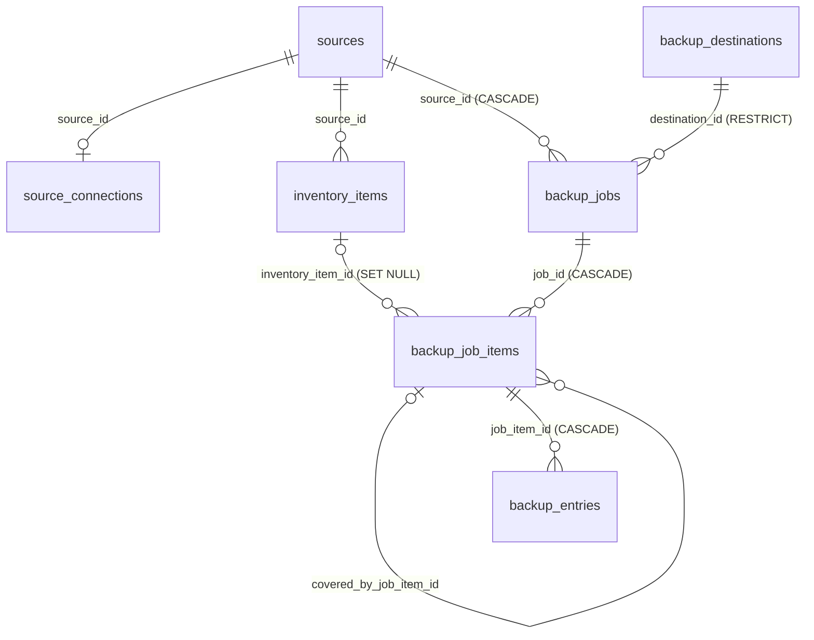

# Exodus Backup: Implementation Plan

[← Backup design](./README.md)

Copy approved inventory items from a source machine (SMB) to an NFS destination, with a frozen scope, hash verification, interruption-safe resume, and a coverage report that says exactly what is and is not backed up.

**Read [facts.md](./facts.md) first.** It holds the decisions that are fixed and the environment facts this plan relies on. This plan does not repeat them; it says what to build.

**Working in a fresh session:** pick one milestone from §7, read §3 to §6 for the parts it touches, and follow the repo rules in facts.md §2 ("Existing code"). Each milestone is its own branch and PR (§7), and ends with updated docs. Nothing here is built yet.

---

## 1. Shape of the system

```
home-hud  ──►  homelab-api  ──►  Postgres (homelab_api)  ◄──  backup-worker ──► NFS export (/volume1/Dump)
 (Backup        (plan, jobs,       backup_* tables              (claims items,       ▲
  pages)         coverage,                                       copies, verifies)   │
                 destinations)                                         │             │
                                                                       └──► Windows source (SMB, smbclient)
```

- **`packages/homelab-db`**: the new tables, migrations and queries (including claim/lease queries the worker calls directly, as `video-worker` does).
- **`packages/source-access`**: the SMB driver, Windows path helpers, secret box and connection-target builder, moved out of `homelab-api` so the worker can use them.
- **`apps/homelab-api`**: planning, job control, destination management, coverage and its JSON export. It never touches the NAS.
- **`apps/backup-worker`**: the only process that reads the source and writes the NAS. One deployment per destination.
- **`apps/home-hud`**: a minimal Backup section (last milestone).
- No MCP tools. No worker HTTP routes: the worker calls `homelab-db` queries.

---

## 2. Vocabulary

| Term           | Meaning                                                                                                                                                                  |
| -------------- | ------------------------------------------------------------------------------------------------------------------------------------------------------------------------ |
| Inventory item | Existing entity: an approved/rejected/pending file or directory of a source (`inventory_items`).                                                                         |
| Destination    | An NFS export Exodus writes to (`backup_destinations`).                                                                                                                  |
| Backup job     | One attempt to copy a frozen selection of inventory items from one source to one destination.                                                                            |
| Job item       | One inventory item inside a job. It is the snapshot, the leased unit of work and the result.                                                                             |
| Entry          | One file or directory beneath a job item (a file item has exactly one, with empty `rel_path`). Holds the hash, destination path, verification state and source metadata. |
| Covered        | An inventory item is _covered at a destination_ when some job item for it, in a job to that destination, is `verified`.                                                  |
| Keep-both      | When the destination path holds different content, the new copy is written to a suffixed name and the existing file is untouched.                                        |
| Staging        | A hidden transient folder on the destination where a file is written and hashed before being linked into place.                                                          |

---

## 3. Data model

New migration after `0015_on_disk_reviews`. Follow the conventions in `docs/exodus/decisions.md`: `path` next to `normalized_path`, CHECK constraints for state invariants, counts derived rather than stored, audit ids without foreign keys. Update `packages/homelab-db/ERD.md` in the same change.

### 3.1 `backup_destinations`

| Column                                           | Notes                                                                                                                                                                        |
| ------------------------------------------------ | ---------------------------------------------------------------------------------------------------------------------------------------------------------------------------- |
| `id` uuid PK, `name` text unique                 |                                                                                                                                                                              |
| `connection_type` enum `backup_destination_type` | `nfs` only. Extensible; settings are typed per type.                                                                                                                         |
| `settings` jsonb                                 | NFS: `{ server, exportPath }`, the _expected_ identity of the mount (`192.168.4.124`, `/volume1/Dump`). Where it is mounted comes from the worker's environment, not the DB. |
| `root_dir` text nullable                         | Optional folder under the mount where Exodus writes. Empty means the mount root (the case for Dump). No `..`, not absolute.                                                  |
| `enabled` boolean                                | Disabled: no new jobs; claims for its jobs answer `destination_disabled`.                                                                                                    |
| `health` enum `unknown\|ok\|unhealthy`           | Written by the worker.                                                                                                                                                       |
| `last_validated_at`, `last_validation` jsonb     | Checks and probe findings (mount type/options, case sensitivity, max name length, `utimes` support, effective uid/gid, free space, `mountVerified`).                         |
| `validation_requested_at` timestamptz nullable   | Set by the API's validate route, cleared by the worker.                                                                                                                      |
| `worker_seen_at` timestamptz nullable            | The worker's last poll, so the UI can say "no worker running".                                                                                                               |
| `created_at`, `updated_at`                       |                                                                                                                                                                              |

Invariant: `settings.server`, `settings.exportPath` and `root_dir` cannot change while the destination has an active job or any verified job item. Moving the data means a new destination.

### 3.2 `backup_jobs`

| Column                                                                         | Notes                                                                                                                                      |
| ------------------------------------------------------------------------------ | ------------------------------------------------------------------------------------------------------------------------------------------ |
| `id`, `source_id` FK (CASCADE), `destination_id` FK (RESTRICT)                 |                                                                                                                                            |
| `status` enum                                                                  | `planned → running → completed \| completed_with_issues \| failed \| cancelled`                                                            |
| `stalled_reason` enum nullable, `stalled_since` timestamptz                    | `destination_unhealthy`, `destination_disabled`, `source_unreachable`. Set by the worker while claims are paused; the job stays `running`. |
| `selection` jsonb                                                              | The request as made: `{ inventoryItemIds?, pathPrefix?, kinds?, skipAlreadyCovered }`.                                                     |
| `source_dir_name` text                                                         | Destination folder for this source (§4.4), frozen at creation.                                                                             |
| `error`, `created_at`, `started_at`, `finished_at`, `updated_at`, `created_by` |                                                                                                                                            |

- Partial unique index: **one active (`planned`/`running`) job per (source, destination)**.
- **Scope is frozen at creation.** Job items are inserted in the same transaction as the job; nothing adds items later. Newly approved inventory needs a new job.
- Counts are derived from job items and entries.
- **Final outcome**, set when no item is `queued` or `in_progress`: `completed` (every item `verified`, `skipped` or `excluded`); `completed_with_issues` (at least one `failed` or `blocked`); `failed` (a human marked it failed); `cancelled` (a human cancelled; leases released, `queued` items stay `queued` as the record). **A completed job never implies full coverage**; coverage is separate (§3.5).

### 3.3 `backup_job_items`

| Group    | Columns                                                                                                                                                                                                                                                           |
| -------- | ----------------------------------------------------------------------------------------------------------------------------------------------------------------------------------------------------------------------------------------------------------------- |
| Identity | `id`, `job_id` FK CASCADE, `inventory_item_id` FK SET NULL; unique `(job_id, inventory_item_id)`                                                                                                                                                                  |
| Snapshot | `kind` (file/directory), `root_path`, `normalized_root_path`, `dest_rel_path`, `carve_outs` jsonb `[{ path, reason: 'rejected_item'\|'exclusion_rule', refId }]`, `covered_by_job_item_id` (self FK, for redundant nested items), `estimated_size_bytes` nullable |
| State    | `status` enum `queued\|in_progress\|verified\|failed\|blocked\|skipped\|excluded`; `status_reason` text (`already_covered`, `redundant_nested`, `excluded_by_rule`, `source_missing`, …)                                                                          |
| Lease    | `attempt_count`, `max_attempts` (**3 file, 5 directory**), `available_at`, `claimed_by`, `last_claimed_by`, `claim_token`, `lease_expires_at`, `last_error`                                                                                                       |
| Progress | `enumeration_complete` boolean, `enumerated_at`, `started_at`, `completed_at`. Entry counts and bytes are derived from `backup_entries`.                                                                                                                          |

CHECKs: `0 ≤ attempt_count ≤ max_attempts`; `in_progress` requires all claim fields; `verified` requires `completed_at` and `enumeration_complete`.

### 3.4 `backup_entries`

One row per file or directory a job item covers. This is the manifest, the resume state, the completeness proof and the metadata store. Source metadata lives only here and in no file on the NAS.

| Column                                                                   | Notes                                                                                                                                                                                                                                                                                         |
| ------------------------------------------------------------------------ | --------------------------------------------------------------------------------------------------------------------------------------------------------------------------------------------------------------------------------------------------------------------------------------------- |
| `id` bigint identity, `job_item_id` FK CASCADE                           |                                                                                                                                                                                                                                                                                               |
| `rel_path`, `normalized_rel_path`                                        | Relative to the item root (`''` for the root). Unique `(job_item_id, normalized_rel_path)`.                                                                                                                                                                                                   |
| `entry_type` enum                                                        | `file`, `directory`                                                                                                                                                                                                                                                                           |
| `status` enum                                                            | `pending`, `verified`, `failed`, `not_followed` (junction/special object)                                                                                                                                                                                                                     |
| `issue_kind` enum nullable, `message` text                               | `failed`: `read_failed` (includes a stream shorter than the file size), `unlistable`, `source_missing`, `name_too_long`, `unsupported_path`, `verify_mismatch`, `write_failed`, `dest_conflict`. `not_followed`: `reparse_point_not_followed`. `verified` with a keep-both copy: `kept_both`. |
| `size_bytes`, `sha256`                                                   | Hash of the source stream; equals the destination hash for a `verified` file.                                                                                                                                                                                                                 |
| `dest_rel_path`                                                          | The path actually written, including any keep-both suffix. Null until written.                                                                                                                                                                                                                |
| `src_created_at`, `src_modified_at`, `src_accessed_at`, `src_changed_at` | `timestamptz`, parsed from `smbclient` run with `TZ=UTC`.                                                                                                                                                                                                                                     |
| `src_attributes` text, `src_streams` jsonb, `src_zone_identifier` text   | Attribute flags (`AHS`…), alternate-stream names and sizes (recorded, **not copied**), `Zone.Identifier` contents (capped at 4 KiB). No owner/ACL.                                                                                                                                            |
| `attempt` int, `verified_at`, `created_at`, `updated_at`                 |                                                                                                                                                                                                                                                                                               |

CHECKs: `verified` requires `verified_at`, and for a file also `sha256` and `dest_rel_path`; `failed` requires `issue_kind`. Index `(job_item_id, status)`.

Rules:

- **Metadata is captured once** (first capture wins) before any other access to the file, and is never overwritten by a retry. Reading a file changes its access time on the source.
- Enumeration upserts entries as `pending` in batches (a few hundred to a thousand), then sets `enumeration_complete`. A retry re-enumerates and upserts; it never duplicates.
- A job item is `verified` only when `enumeration_complete` is true and no entry is `pending` or `failed`.
- Per-file work volume can reach hundreds of thousands of rows. Batch writes, page reads, no per-row audit events.

### 3.5 Coverage (derived, no table)

> Inventory item **I is covered at destination D** when some `backup_job_items` row for I with status `verified` exists in a job targeting D. Or I is a redundant nested item (`covered_by_job_item_id` set) whose covering item is `verified` and has a `verified` entry at I's path.

Verified data is never deleted, so a later failed job does not revoke coverage; the report also shows the latest attempt. Index `(inventory_item_id, status)`.

Every inventory item of the source lands in exactly one bucket for a destination:

| Bucket               | Rule                                                      | Blocks `allAccounted`? |
| -------------------- | --------------------------------------------------------- | ---------------------- |
| `covered`            | as above                                                  | no                     |
| `redundant_covered`  | nested approved item whose covering item verified it      | no                     |
| `excluded_rule`      | approved but under an `exclude_subtree` rule              | no (intentional)       |
| `rejected`           | decision `rejected` (final)                               | no (intentional)       |
| `undecided`          | decision `pending`                                        | **yes**                |
| `pending`            | eligible and in an active job, not terminal               | **yes**                |
| `failed` / `blocked` | latest job item is failed/blocked and never verified at D | **yes**                |
| `never_attempted`    | eligible, no job item ever at D                           | **yes**                |

`allAccounted` is true only when no item is in a blocking bucket. The response states its own scope ("inventory items, with per-file verification for directory items, subject to the stated limits") and carries display-only extras: discovery review status, kept-both counts, `not_followed` notes. Rejected items are counted and listed with `bucket=rejected`.

### 3.6 Audit

Add nullable, no-FK columns `destination_id`, `backup_job_id`, `backup_job_item_id` to `audit_events` (extend `insertAuditEvent` and `listAuditEvents` filters), and these `AuditEventType` values, each written in the same transaction as its change:

`backup_destination.created|updated|enabled|disabled|validated|unhealthy`, `backup_job.created|started|completed|completed_with_issues|cancelled|failed|stalled|resumed`, `backup_job_item.verified|attempt_failed|blocked|failed|retried`, `backup_job_items.lease_expired` (actor `system`, batched). Details: selection and counts at creation; validation failures and probe findings; errno or watchdog on `unhealthy`; attempt and failure counts on `attempt_failed`. **No per-file events.** Worker events use actor type `system` with the worker id.

### 3.7 Entity relationships



---

## 4. Behaviour

### 4.1 Planning (API; `plan` is a dry run, `create` is the same logic plus a transactional insert)

For each inventory item of the source matching `selection` (default: all):

1. `decision ≠ approved` → not included; listed in the plan as `notEligible` with a reason.
2. Under an `exclude_subtree` rule (`resolveExclusion`) → job item `excluded` (`excluded_by_rule`).
3. Nested inside another approved candidate of this job → `skipped` (`redundant_nested`), `covered_by_job_item_id` set.
4. `skipAlreadyCovered` (default true) and already covered at D → `skipped` (`already_covered`).
5. Otherwise `queued`, with `max_attempts` 3 (file) or 5 (directory).

For queued directory items, `carve_outs` collects nested `rejected` inventory items and nested `exclude_subtree` rules (the copy rule in `docs/exodus/inventory.md`: nearest decided item wins; a rejected nested item is a carve-out). `dest_rel_path` is computed (§4.4); when the item has a prior `verified` job item at D, its `dest_rel_path` is reused so a changed path spelling cannot split the tree. The plan reports the summed `estimated_size_bytes` and how many items have no estimate, warns if a discovery job is active, warns if `<source_dir_name>/` already exists at the destination, and rejects an empty selection. The job is refused (409) for a disabled destination, or when another active job exists for the (source, destination).

### 4.2 Worker loop and leases

Modelled on `video-worker` (Express `/healthz` and `/readyz`, poll loop, migrations at startup under the advisory lock). Per iteration:

1. Update `worker_seen_at`; handle a pending `validation_requested_at` (and validate once at startup).
2. **Pre-flight.** Destination: mount identity and a quick write check; on failure the destination becomes `unhealthy`, the job's `stalled_reason` is `destination_unhealthy`, and claims answer `{ item: null, reason: 'destination_unhealthy', retryAt }`. Source: `driver.test`; on failure `stalled_reason` is `source_unreachable`, with backoff. **No attempts are spent while stalled.** Recovery clears `stalled_reason` (audit `resumed`).
3. **Claim** one job item of this worker's destination: one transaction, lock the job row (`FOR NO KEY UPDATE`), expire leases, pick with `FOR UPDATE SKIP LOCKED`; return a `claimToken`. The first claim moves `planned → running`.
4. **Process** the item (§4.3). `BACKUP_PARALLELISM` (default 1) sets how many files of the item move at once.
5. **Heartbeat** every 60 s (lease 300 s), including while hashing a large file.
6. **Finish.** `verified` if enumeration is complete and no entry is `pending` or `failed`. Otherwise: only transient failures (`read_failed`, `write_failed`, `verify_mismatch`) and attempts left → `queued` with backoff (30 s doubling, capped at 1 h); any non-transient failure (`source_missing`, `name_too_long`, `unsupported_path`, `dest_conflict`, `unlistable`) → `blocked`; attempts exhausted → `failed`.
7. On `queue_empty`, run the job completion check (final status, §3.2).

Rules copied from discovery: `complete`/`fail` repeated with the same token answer from the settled row; every item mutation is guarded by an `activeClaim` condition in the `WHERE` clause (token, state, lease, job active); expiry is lazy and spends an attempt; `release` refunds; human `retry` grants exactly one more attempt and only while the job is active.

**Stalls and shutdown**

- **Source stall:** no bytes for `BACKUP_STALL_TIMEOUT_SECONDS` (120) → kill the transfer, transient `read_failed`.
- **Destination stall:** the NAS mount is `hard`, so an outage blocks calls. Each destination operation runs under a watchdog; if none makes progress for the stall timeout the worker **stops heartbeating**, marks the destination unhealthy and fails `/readyz` (and `/healthz` after a longer grace) so the pod restarts and the lease expires. Otherwise the heartbeat timer would keep a hung item leased forever.
- **`SIGTERM`:** stop claiming, abort the transfer, delete the staging file, **release the item and refund the attempt**; verified entries stay verified. A hard crash spends one attempt; the next attempt resumes from `backup_entries`.
- **Memory is tight:** stream every file with bounded buffers, hash incrementally, never hold a listing in memory, run at most `BACKUP_PARALLELISM` `smbclient` children.

### 4.3 Copying one item

**Every step is safe to interrupt and repeat.** Killing the worker or switching off the source at any point and rerunning yields the same destination tree, with nothing overwritten, duplicated or left behind.

Enumeration (directory items): one `recurse ON; ls` per directory; insert entries as `pending`; reparse points become `not_followed` entries; carve-outs are skipped; unlistable subdirectories become `failed` `unlistable` entries.

Per entry:

1. **Capture metadata first**, before reading the file: `allinfo` (batched, several paths per `smbclient` session; if the number of result blocks does not match the batch, redo it one by one) for size, four times, attributes and stream list; if a `Zone.Identifier` stream exists, `get` it. Write to the entry only if not already recorded. Missing file → `source_missing` (for the item root, the item is `blocked`).
2. Resolve the destination path (§4.4) and check the root boundary.
3. **Skip if done:** entry `verified`, its `dest_rel_path` exists as a regular file and its size matches.
4. **Conflict handling.** If the final path exists as a regular file: same size and SHA-256 → **adopt** (mark verified). Different → **keep both**: leave it untouched and use `<stem>.exodus-<first 8 chars of job id>.<ext>` in the same directory (mark `kept_both`); if that name exists with identical content, adopt it; with different content, `dest_conflict`. A directory where a file must go, or a file where a directory must be created → `dest_conflict`.
5. **Stage:** stream the source into `<mount>/<root_dir>/.exodus-staging/<jobItemId>/<entryId>`, hashing as it goes, then `fsync`. If the streamed byte count differs from the `stat` size → `read_failed`, delete the staging file (`smbclient` can end a stream early without an error).
6. **Place without clobbering:** `link(staging, final)` fails with `EEXIST` rather than overwriting; on `EEXIST` go back to step 4. Then `unlink(staging)` and `utimes(final, srcModified)`.
7. **Verify:** re-read the destination, hash it, compare with the source hash. Mismatch → `verify_mismatch`; delete only the file this attempt created.
8. **Record:** entry `verified` with hash, size, `dest_rel_path`, `verified_at`.

After the item: set directory modification times bottom-up (writing children changes a directory's time), remove its empty staging folder (and `.exodus-staging` when empty). Leftover staging files of an item are deleted at the start of its next attempt.

### 4.4 Destination layout and safety

```
<BACKUP_DESTINATION_PATH>/[<root_dir>/]
  <source_dir_name>/             e.g. alpha-centauri/
    C/Users/Me/Pictures/...      drive letter as a folder, no colon
    UNC/<server>/<share>/...     for UNC inventory paths
  .exodus-staging/               only while a copy is in flight
```

- Nothing else is ever written: **no markers, manifests or reports**. The validation probe uses a transient `.exodus-probe-<random>/` folder, removed afterwards.
- `source_dir_name`: a slug of the source name, chosen for the first job and reused from the latest prior job at the destination. Planning refuses a name already used by another source there. The export contains unrelated files; Exodus only creates and writes inside `<source_dir_name>/` and never touches anything else.
- Mapping from inventory path: each `\` → `/`, `C:` → `C`; descendants use the spelling the listing returns. It is a pure function, so retries land on the same paths.
- Root boundary: resolve with `path.posix`, reject `..`, absolute segments and NUL, and `lstat` every existing component under the root so symlinks are refused (follow `apps/video-worker/src/lib/safe-path.ts`, plus the symlink check).
- Names over 255 bytes (including a keep-both suffix) → `name_too_long`. Paths `smbclient` cannot address (`;`, `"`, line breaks; `assertSafeForCommand`) → `unsupported_path`.
- Special objects (junctions, devices) are not followed (`not_followed`). Empty directories are created and recorded. Junk files are copied.
- Never delete or overwrite destination data; never propagate source deletions.
- NFS errors: `EIO`/`ESTALE`/`ENOTCONN`/missing mount, `ENOSPC`, `EACCES` on the root → release (refund), destination `unhealthy`, back off. `EACCES` under the root → `write_failed` entry.

### 4.5 Verification and limits

A file is verified when the destination re-read hash equals the source stream hash and the streamed size equals the `stat` size. Only the modified time is applied to the NAS file; creation time cannot be set over NFS and lives in the database. Ownership and permissions are not preserved.

What this design cannot guarantee, and the coverage response must say so:

1. Files hidden from the SMB account are invisible; enumeration cannot prove they do not exist.
2. Coverage covers _inventory_, not the whole disk; whether inventory is complete is the discovery workflow's job.
3. A file modified during the copy (a consistent but different version) is not detected.
4. ACLs and alternate-stream _contents_ (other than `Zone.Identifier`) are not preserved.
5. The copy itself changes the source's last-access times (originals are in the database).

---

## 5. API and UI

All REST, human actor only, documented in OpenAPI (`/docs`).

| Route                                                                    | Purpose                                                                        |
| ------------------------------------------------------------------------ | ------------------------------------------------------------------------------ |
| `POST/GET /backup-destinations`, `GET/PATCH /backup-destinations/:id`    | Create, list, edit (identity fields immutable per §3.1).                       |
| `POST /backup-destinations/:id/{validate,enable,disable}`                | `validate` returns 202 and sets `validation_requested_at`; the worker does it. |
| `POST /sources/:id/backup-jobs/plan`                                     | Dry run (§4.1).                                                                |
| `POST /sources/:id/backup-jobs`                                          | Create a `planned` job with a frozen scope.                                    |
| `GET /backup-jobs`, `GET /backup-jobs/:id`                               | Jobs with derived counts and `stalledReason`.                                  |
| `POST /backup-jobs/:id/{start,cancel,fail}`                              | Guarded transitions.                                                           |
| `GET /backup-jobs/:id/items?status=`, `GET /backup-job-items/:id`        | Item-level results.                                                            |
| `GET /backup-job-items/:id/entries?status=&issueKind=`                   | Paged per-file results and metadata.                                           |
| `POST /backup-job-items/:id/retry`, `POST /backup-jobs/:id/retry-failed` | One more attempt each; active job only.                                        |
| `POST /backup-jobs/:id/rerun-unresolved`                                 | New job from the failed and blocked items of a finished job.                   |
| `GET /sources/:id/backup-coverage?destinationId=&bucket=&format=json`    | Coverage report; `format=json` downloads the full report.                      |

**home-hud (last milestone, minimal):** a new **Backup** entry under Exodus (`/exodus/backup`). Overview: destination health (and "no worker running" when `worker_seen_at` is stale), a Validate button, and one **Start backup job** button that runs `plan`, shows the numbers (items to copy, excluded, not eligible, estimated size, items without an estimate, warnings) and on confirm creates and starts the job. Job page: status and `stalledReason`, derived progress, item list with status and last error, Cancel. Coverage page: buckets, `allAccounted`, discovery status, Download JSON. Follow the existing Exodus pages: all text through `Typography` with no font or colour overrides, `fui-components` only from client components, server actions return results instead of throwing (`docs/exodus/ui.md`, `decisions.md`).

---

## 6. Worker configuration

| Variable                                            | Default           | Purpose                                                                            |
| --------------------------------------------------- | ----------------- | ---------------------------------------------------------------------------------- |
| `POSTGRES_HOST/PORT/DATABASE/USER/PASSWORD`         | as `video-worker` | The shared `homelab_api` database.                                                 |
| `EXODUS_CREDENTIAL_KEY`                             | required          | Decrypts the source connection password.                                           |
| `BACKUP_DESTINATION_ID`                             | required          | The destination this worker serves.                                                |
| `BACKUP_DESTINATION_PATH`                           | required          | Container path of the mounted export (local dev: a sample directory).              |
| `BACKUP_DESTINATION_MOUNT_CHECK`                    | `nfs`             | `none` only for local development; the result then records `mountVerified: false`. |
| `BACKUP_PARALLELISM`                                | `1`               | Files of one item copied at once.                                                  |
| `BACKUP_STALL_TIMEOUT_SECONDS`                      | `120`             | No-progress timeout for source reads and destination operations.                   |
| `BACKUP_HEARTBEAT_SECONDS` / `BACKUP_LEASE_SECONDS` | `60` / `300`      | Heartbeat interval and lease length.                                               |
| `POLL_INTERVAL_MS`                                  | as `video-worker` | Idle poll interval.                                                                |

`smbclient` children always run with `TZ=UTC`.

**Destination validation** (run by the worker on request and at startup) passes only if all hold: (1) `BACKUP_DESTINATION_PATH` is a mount point whose `/proc/mounts` entry is an NFS filesystem of `settings.server:exportPath` (skipped when the mount check is `none`); (2) `<mount>/<root_dir>` exists or can be created and no component is a symlink; (3) a probe in a transient `.exodus-probe-<random>/` folder writes, fsyncs, reads back and matches a hash, `link()`s without clobbering, renames, sets `utimes`, and creates a 255-byte name, a case-variant pair and awkward names (spaces, trailing dots, non-ASCII), then is removed; (4) free space and the effective uid/gid are reported (information only). The result goes to `last_validation`.

---

## 7. Milestones

Each milestone is its own branch and PR, **started from `feat/exodus-refinement`** (a milestone that needs an unmerged earlier one branches from that milestone's branch). Each leaves the repo green: `pnpm build`, lint, `pnpm test:unit`, and where a database is involved `pnpm test:int` (needs `pnpm dev:deps`; **rebuild `homelab-db` after changing it**, `homelab-api` loads its `dist/`). Update docs in the same change (§8).

### M0: extract the shared SMB code (pure refactor) — done

Implemented on `feat/exodus-backup-m0-source-access`; tests moved to `packages/source-access/tests/unit/`.

Branch `feat/exodus-backup-m0-source-access`.

- Create `packages/source-access` (`@abbottland/source-access`), set up like a sibling package (typescript-config, eslint-config, jest-presets; catalog dependencies per `docs/dev-guide-dependency-management.md`).
- Move from `apps/homelab-api`: `src/lib/connections/{types,smb,index}.ts`, `src/lib/windows-path.ts`, `src/lib/secret-box.ts`, and their unit tests. Extract the pure `buildConnectionTarget(connection, host)` from `loadTarget` in `services/discovery/source-connections.ts`.
- The package imports `SourceConnectionType` and `SourceConnectionSettings` from `homelab-db`, type-only.
- Update all imports in `homelab-api` (and its Dockerfile/build if the package must be copied in).
- **No new behaviour.** The existing homelab-api unit and integration suites pass unchanged. The `TZ=UTC` environment is added in M4, not here.
- Docs: root `CLAUDE.md` package list, `docs/dev-guide-monorepo-architecture.md` if it lists packages.
- Acceptance: Given the refactor, when the full homelab-api suites run, then they pass unchanged; the API's SMB test connection and preview still work against the dev source.

### M1: schema and queries (`packages/homelab-db`) — done

Implemented on `feat/exodus-backup-m1-schema` (migration `0016_backup`); the built behaviour is in [`docs/exodus/backup.md`](../backup.md). Integration tests are `apps/homelab-api/tests/integration/backup-*.integration.test.ts`.

Branch `feat/exodus-backup-m1-schema`.

- Schema in `src/schema/` (a new `backup.ts`, exported from `index.ts`): §3.1 to §3.4 with their enums, unique and partial unique indexes, CHECKs and foreign keys; audit columns and `AuditEventType` values (§3.6). Generate the migration (`drizzle-kit generate` needs a pseudo-terminal: see `docs/exodus/decisions.md`). Update `ERD.md`.
- Queries in `src/queries/backup/` (one file per subdomain: `destinations`, `jobs`, `items`, `entries`, `claims`, `coverage`), patterned on `queries/discovery/claims.ts` and `queue-helpers.ts`: `activeClaim`, `settledByClaim`, lease expiry, claim with the job-row lock, heartbeat, complete, fail with backoff, release with refund, human retry, job transitions, final-outcome check, stalled-reason set/clear, batched entry upsert with first-capture-wins metadata, derived counts, the coverage query and buckets.
- Tests: schema unit tests (like `src/schema/discovery.unit.test.ts`); integration tests in `apps/homelab-api/tests/integration/` against the dev database: concurrent claims never return the same item; lease expiry requeues and spends the attempt, and fails on the last attempt; idempotent complete; late worker rejected after cancel; CHECKs reject illegal states; entry upsert is idempotent and does not overwrite captured metadata; coverage buckets per destination (verified at A only → `never_attempted` at B; verified then failed → still `covered`).
- Acceptance: per the tests above.

### M2: API (`apps/homelab-api`)

Branch `feat/exodus-backup-m2-api`.

- Services (`services/backup/`), controllers, routes, schemas and OpenAPI for §5, following the discovery layout (`controllers/discovery/handle.ts` etc.). Planning (§4.1) reuses `resolveExclusion`, the path helpers (`isWithinPath`, `ancestorsOf`) and the nested-item lookup used by path coverage. Coverage and the JSON download. Destination invariants (§3.1). `validate` only sets `validation_requested_at`.
- No MCP changes. Update `apps/homelab-api/README.md` and the OpenAPI docs.
- Docs: start `docs/exodus/backup.md` with the facts of what is built (data model, API); link it from `docs/exodus/README.md`, `data-model.md` and `api.md`.
- Tests: unit and integration for every route; planning cases (unapproved excluded from the job and listed, `exclude_subtree` → `excluded`, nested → `skipped`, already covered → `skipped`, carve-outs recorded, empty selection rejected, active job conflict, disabled destination, discovery-active warning, existing-folder warning); a running job's scope does not change when inventory changes; every state change writes exactly one audit event in its transaction and a rejected request writes none.

### M3: `apps/backup-worker` scaffold, validation, build and CI

Branch `feat/exodus-backup-m3-worker`.

- App copied from `apps/video-worker`'s structure (`config.ts` with §6, `db.ts`, `server.ts`, `process.ts`, `worker/poll-loop.ts`, `lib/safe-path.ts` plus the symlink check, Dockerfile with `apk add samba-client`, `abctl.yml`/`abctl.base.yml`, `docker-compose.yaml` for local dev against a sample directory, `sample.env`, README).
- Destination validation (§6) with injectable `/proc/mounts`, filesystem and clock; `worker_seen_at` and `validation_requested_at` handling; the destination watchdog and `/readyz` behaviour. The worker does not copy yet.
- Image build, publication and CI wiring following `video-worker` (`docs/dev-guide-publication.md`, `.github/CLAUDE.md`).
- Create the **GitHub issue in `pbabbott/home-kubernetes`** with the body in Appendix A (use `gh`; **confirm the text with the user before creating**). Do not touch that repository otherwise.
- Tests: validation unit tests (wrong mount type, wrong `server:exportPath`, symlinked root, probe failures, `mountVerified: false` when the check is `none`, the probe folder removed, nothing left under the root); integration: `POST …/validate` → worker clears the request and writes `last_validation`.

### M4: the copy engine

Branch `feat/exodus-backup-m4-copy`.

- **Spike first (time-boxed, read-only, approved paths only, scratch directory only; permission is in facts.md).** Measure large-file throughput (the 547 MB zip), many-small-file behaviour (batched `get` or tar streaming only if per-file `get` is too slow), a safe `allinfo` batch size, and how `ls` flags reparse points. Write results into this plan (§10) before building on them.
- Extend the `source-access` driver interface and the SMB driver: `TZ=UTC` in the child environment; a tree listing (`recurse ON; ls`); batched `allinfo` with parsing of times, attributes and streams; a streaming read (`get … -`) that supports a stall timeout; reading a small named stream (`Zone.Identifier`). Add a **fake driver** for tests.
- Worker: §4.3 end to end, first for file items, then directory items (enumeration into entries, carve-outs, redundant nested resolution, resume, bottom-up directory times), keep-both and adoption, staging and `link()`, entry metadata capture, the retry/finish rules of §4.2 step 6.
- Tests (temp directories and the fake driver, `BACKUP_DESTINATION_MOUNT_CHECK=none`):
  - Given a file item, the destination hash equals the source hash, the modified time matches, no staging file remains, and the item is `verified` with a complete entry.
  - Given the stream ends before the stat size, the entry fails with `read_failed` and the staging file is discarded.
  - Given an identical destination file, it is adopted; given a different one, it is untouched, the copy exists at the suffixed name, the entry is `verified` with `kept_both`, and a retry does not duplicate it.
  - Given a file where a directory must go, the item is `blocked` with `dest_conflict`.
  - Given a missing source file, the item is `blocked` with `source_missing`.
  - Given a directory with one unreadable descendant, everything else is verified, the item is not, and a retry copies only the missing file.
  - Given a worker killed at any point mid-directory (inject faults between steps), a rerun produces a tree identical to an uninterrupted run, with no overwrite, no duplicate and no staging file.
  - Given a junction, it is not traversed and a `not_followed` entry exists.
  - Given a path that escapes the root or crosses a symlink, nothing is written and the entry fails with `unsupported_path`.
  - Given a retry, captured `src_*` metadata is unchanged.
  - Given existing unrelated files and folders at the destination, none is read, changed or removed, and no marker, manifest or report is created.

### M5: resilience and operations

Branch `feat/exodus-backup-m5-ops`.

- Stall timeout and `BACKUP_PARALLELISM` behaviour; `SIGTERM` release with refund; `source_unreachable` and `destination_unhealthy` pauses with `stalled_reason` and `stalled`/`resumed` audit events; the destination I/O watchdog (stop heartbeating, fail probes); human retry, `retry-failed`, `rerun-unresolved`, cancel and fail semantics end to end; lease-expiry audit batching.
- Turn the races and failure modes into integration tests, as `docs/exodus/decisions.md` recommends (probe races against the running API and worker, then keep each as a test).
- Tests: no bytes for the stall timeout → transient `read_failed`; unreachable source → claims pause, no attempt spent, one `stalled` event, and `resumed` when it answers; a destination call that never returns → heartbeats stop, destination `unhealthy`, `/readyz` fails; `SIGTERM` mid-copy → staging deleted, item released with the attempt refunded, verified entries kept; cancelled job → late heartbeat/complete rejected; retry grants exactly one more attempt and only on an active job.
- Measure memory against the limits in Appendix A and adjust the issue if needed.

### M6: home-hud pages (last, minimal)

Branch `feat/exodus-backup-m6-ui`. May start once M2 lands but is sequenced last. §5 "home-hud". Follow the Exodus page conventions; update `docs/exodus/ui.md`. Unit tests for display helpers as the existing pages do; never run Playwright snapshot tests locally.

### First real run (runbook, after M0 to M5)

1. Mount `192.168.4.124:/volume1/Dump` into the worker (the `home-kubernetes` work), set `BACKUP_DESTINATION_ID` and `BACKUP_DESTINATION_PATH`. Create the destination in the API and validate until `ok`; read the probe findings (uid, `utimes`, case sensitivity).
2. Create a job selecting only `C:\backup-test\Brandchelor Party.zip` and one small directory (for example `…\GameMaker\Backups\ZeldaClone`). Start it.
3. Check the NAS tree under `alpha-centauri/C/…`, the entries and metadata in the database, and the coverage report (both `covered`; others `never_attempted`). Kill the worker mid-copy once and confirm it resumes cleanly.
4. Run the full approved set (136 items). Review `completed_with_issues` items, fix causes, `rerun-unresolved`. Download the JSON coverage report.

---

## 8. Documentation rules

Documentation describes what exists, so write facts into the main Exodus docs as each milestone lands, and delete the matching part of this plan:

- `docs/exodus/backup.md` (new): the built behaviour.
- `docs/exodus/data-model.md`, `api.md`, `processing.md`, `ui.md`, `operations.md`, `README.md`: update status tables and links.
- `packages/homelab-db/ERD.md`, `apps/homelab-api/README.md` and OpenAPI, the new app's README. `CLAUDE.md` files stay index-only (`docs/dev-guide-documentation-conventions.md`).
- When the last milestone ships, remove `docs/exodus/backup-design/` and the README link.

---

## 9. Open items

1. **Opening PRs.** The user has not said whether the agent may push branches and open PRs. Stop before pushing and ask.
2. **Export permissions.** "uid 100" in the user's answer is taken as uid 1000; the validation probe confirms.
3. **Unmeasured:** large-file throughput over the dedicated cable (M4 spike), the real total size of the approved set, and whether the memory limit in Appendix A holds (M5).

## 10. Spike results

_(Filled in during M4.)_

---

## Appendix A: body of the `home-kubernetes` issue (created at the start of M3)

The issue will be implemented later by **another Claude session in `pbabbott/home-kubernetes`**, so it must stand alone and assume no knowledge of this plan.

Title: **Add backup-worker (Deployment, PV/PVC, secrets) to the `home-hud` namespace**

**Context.** `backup-worker` is a new Node service from `pbabbott/home-web-apps` (`apps/backup-worker`). It copies files from a Windows machine (over SMB) to an NFS export on the NAS and records progress in the existing `homelab_api` Postgres database. It is modelled on `video-worker`: an Express server (`/healthz`, `/readyz`) plus a poll loop. The image is built and published by that repo's CI to Harbor, like `video-worker`. This repo (Flux) owns the manifests; follow the conventions `video-worker` and `video-api` already use here (how secrets are referenced, labels, image reference style, kustomization layout).

**Please add, in namespace `home-hud`:**

1. **PersistentVolume and PersistentVolumeClaim for the destination export.**
   - NFS server `192.168.4.124`, path `/volume1/Dump`. This is a **different export from `/volume1/Media`** (`media-pvc`), so it needs its **own PV and PVC**; do not reuse `media-pvc`.
   - `persistentVolumeReclaimPolicy: Retain` (the export holds data Kubernetes must never delete), `storageClassName: ""`, `ReadWriteMany`, a nominal capacity.
   - NFS v4.2 like the media mount, keeping the `hard` option (the worker is written to cope with a stalled mount).
   - The export contains unrelated files. The worker only writes under `/backup/<source name>/…`.
2. **Deployment `backup-worker`.**
   - `replicas: 1`, `strategy: Recreate`: exactly one worker per destination, never two overlapping in a rollout.
   - Image from Harbor, same registry and tag style as `video-worker`.
   - `runAsUser: 1000`, `runAsGroup: 1000`, as `video-worker`. The export is writable by that user.
   - Mount the new PVC at `/backup`.
   - `terminationGracePeriodSeconds: 60` or more: on `SIGTERM` the worker aborts the transfer and releases its work item.
   - Probes: readiness `GET /readyz`, liveness `GET /healthz`. The worker fails them on purpose when the NAS mount hangs, so give liveness a generous `failureThreshold`/`periodSeconds` (a minute or more of failures).
   - Resources, deliberately small: requests `cpu: 50m`, `memory: 128Mi`; limit `memory: 256Mi`, no CPU limit. (`video-worker` requests 100m/256Mi with a 1Gi limit.) These are estimates to validate in the first real run.
   - Environment: the Postgres variables exactly as `video-worker` gets them; `BACKUP_DESTINATION_PATH=/backup`; `BACKUP_DESTINATION_ID=<uuid>` (supplied by the person running the migration; leave a clearly marked placeholder or a ConfigMap value); `BACKUP_DESTINATION_MOUNT_CHECK=nfs`. Leave the tuning variables at their defaults.
   - Secrets: the Postgres credentials (as `video-worker`) and `EXODUS_CREDENTIAL_KEY`, the **same value** `homelab-api` uses, referenced the same way.
3. **Network.** The pod must reach the Windows machine on TCP 445 and the NAS over NFS. This works from the `home-hud` namespace; no NetworkPolicy change is expected.

**Do not:** mount this export into `homelab-api` or any other pod; add an Ingress or Service beyond what the probes need; change anything for `video-worker`.

**Acceptance checks** (read-only; do not write test files to the export):

- `kubectl -n home-hud exec deploy/backup-worker -- grep /backup /proc/mounts` shows an `nfs4` mount of `192.168.4.124:/volume1/Dump`.
- `kubectl -n home-hud exec deploy/backup-worker -- id` shows uid/gid 1000.
- The pod becomes `Ready` and stays so; the logs show it polling and validating its destination.
- Deleting the pod terminates within the grace period and Flux recreates it.
