# homelab-db ERD

Entity-relationship diagram for the `homelab_api` database. Source of truth is `src/schema/`; keep this in sync when a migration changes a table.

```mermaid
erDiagram
    hosts ||--o{ sources : "host_id (RESTRICT, optional)"
    sources ||--o{ discovery_jobs : "source_id (CASCADE)"
    discovery_jobs ||--o{ discovery_queue_items : "job_id (CASCADE)"
    sources |o--o{ exclusion_rules : "source_id (CASCADE)"
    sources ||--o{ inventory_items : "source_id (CASCADE)"
    sources ||--o| source_connections : "source_id (CASCADE)"
    sources ||--o{ skip_acknowledgements : "source_id (CASCADE)"
    sources ||--o{ on_disk_reviews : "source_id (CASCADE)"
    discovery_queue_items |o--o{ skip_acknowledgements : "queue_item_id (SET NULL)"
    discovery_queue_items |o--o{ on_disk_reviews : "queue_item_id (SET NULL)"
    discovery_jobs |o--o{ inventory_items : "first_job_id (SET NULL)"
    discovery_jobs |o--o{ inventory_items : "last_job_id (SET NULL)"
    discovery_queue_items |o--o{ inventory_items : "last_queue_item_id (SET NULL)"
    sources ||--o{ backup_jobs : "source_id (CASCADE)"
    backup_destinations ||--o{ backup_jobs : "destination_id (RESTRICT)"
    backup_jobs ||--o{ backup_job_items : "job_id (CASCADE)"
    inventory_items |o--o{ backup_job_items : "inventory_item_id (SET NULL)"
    backup_job_items |o--o{ backup_job_items : "covered_by_job_item_id (SET NULL)"
    backup_job_items ||--o{ backup_entries : "job_item_id (CASCADE)"

    hosts {
        uuid id PK
        text name
        host_type host_type "physical | virtual"
        exporter_type exporter_type "node_exporter | windows_exporter"
        text ip_address
        text instance UK "nullable"
        text model3d "nullable"
        timestamptz created_at
    }

    sources {
        uuid id PK
        text name UK
        uuid host_id FK "nullable"
        source_type source_type "windows"
        timestamptz created_at
        timestamptz updated_at
    }

    source_connections {
        uuid source_id PK, FK
        source_connection_type connection_type "smb"
        text username
        text domain "nullable"
        text secret_ciphertext "encrypted by the API, never returned"
        jsonb settings "shareMappings"
        timestamptz last_tested_at "nullable"
        boolean last_test_ok "nullable"
        text last_test_error "nullable"
        timestamptz created_at
        timestamptz updated_at
    }

    discovery_jobs {
        uuid id PK
        uuid source_id FK
        text root_path
        text normalized_root_path
        discovery_job_status status "pending | running | completed | failed | cancelled"
        text error "nullable"
        timestamptz created_at
        timestamptz started_at "nullable"
        timestamptz finished_at "nullable"
        timestamptz updated_at
    }

    discovery_queue_items {
        uuid id PK
        uuid job_id FK
        text path
        text normalized_path "UK with job_id"
        discovery_queue_item_status status "queued | in_progress | completed | failed | skipped"
        int priority
        int attempt_count
        int max_attempts
        text last_error "nullable"
        text reason "nullable, why it was queued"
        jsonb result "nullable, summary + paths skipped without queueing"
        timestamptz available_at
        text claimed_by "nullable"
        text last_claimed_by "nullable, kept after release/expiry/failure"
        uuid claim_token "nullable"
        timestamptz lease_expires_at "nullable"
        timestamptz created_at
        timestamptz updated_at
        timestamptz completed_at "nullable"
    }

    inventory_items {
        uuid id PK
        uuid source_id FK "UK with normalized_root_path"
        uuid first_job_id FK "nullable"
        uuid last_job_id FK "nullable, most recent proposing job"
        uuid last_queue_item_id FK "nullable, most recent proposing queue item"
        inventory_item_kind kind "file | directory"
        text root_path
        text normalized_root_path
        text display_name
        text summary
        inventory_item_recommendation recommendation "back_up | skip | needs_review (agent)"
        inventory_item_confidence confidence "low | medium | high (agent)"
        text recommendation_reason "agent"
        jsonb evidence "agent, InventoryItemEvidence"
        timestamptz recommended_at "when recommendation, confidence or reason last changed"
        text recommended_by "nullable"
        inventory_item_decision decision "pending | approved | rejected (human), default pending"
        text decision_note "nullable"
        timestamptz decided_at "nullable, set unless pending"
        text decided_by "nullable"
        timestamptz first_seen_at
        timestamptz last_seen_at
        timestamptz created_at
        timestamptz updated_at
    }

    exclusion_rules {
        uuid id PK
        uuid source_id FK "nullable, null = global; UK with normalized_path (NULLS NOT DISTINCT)"
        text path
        text normalized_path
        exclusion_rule_scope scope "selective_only | exclude_subtree"
        text reason "nullable"
        timestamptz created_at
        timestamptz updated_at
    }

    skip_acknowledgements {
        uuid id PK
        uuid source_id FK
        text path
        text normalized_path
        text pattern "empty for a plain path skip"
        uuid queue_item_id FK "nullable, where acknowledged"
        text acknowledged_by
        timestamptz created_at
    }

    on_disk_reviews {
        uuid id PK
        uuid source_id FK
        text path "the reviewed directory"
        text normalized_path
        uuid queue_item_id FK "nullable, where acknowledged"
        text reviewed_by
        timestamptz created_at
    }

    backup_destinations {
        uuid id PK
        text name UK
        backup_destination_type connection_type "nfs"
        jsonb settings "expected mount identity { server, exportPath }"
        text root_dir "nullable, relative folder under the mount"
        boolean enabled
        backup_destination_health health "unknown | ok | unhealthy (worker)"
        timestamptz last_validated_at "nullable"
        jsonb last_validation "nullable, probe findings"
        timestamptz validation_requested_at "nullable, set by the API, cleared by the worker"
        timestamptz worker_seen_at "nullable, worker's last poll"
        timestamptz created_at
        timestamptz updated_at
    }

    backup_jobs {
        uuid id PK
        uuid source_id FK
        uuid destination_id FK
        backup_job_status status "planned | running | completed | completed_with_issues | failed | cancelled"
        backup_job_stalled_reason stalled_reason "nullable, destination_unhealthy | destination_disabled | source_unreachable"
        timestamptz stalled_since "nullable, set with stalled_reason"
        jsonb selection "the request as made"
        text source_dir_name "destination folder for this source, frozen"
        text error "nullable"
        text created_by "nullable"
        timestamptz created_at
        timestamptz started_at "nullable"
        timestamptz finished_at "nullable, set once not planned/running"
        timestamptz updated_at
    }

    backup_job_items {
        uuid id PK
        uuid job_id FK
        uuid inventory_item_id FK "nullable; UK with job_id"
        inventory_item_kind kind "file | directory"
        text root_path
        text normalized_root_path
        text dest_rel_path "path under the destination source folder"
        jsonb carve_outs "rejected items and exclusion rules inside a directory"
        uuid covered_by_job_item_id FK "nullable, redundant nested item"
        bigint estimated_size_bytes "nullable"
        backup_job_item_status status "queued | in_progress | verified | failed | blocked | skipped | excluded"
        text status_reason "nullable"
        int attempt_count
        int max_attempts "3 file, 5 directory"
        timestamptz available_at
        text claimed_by "nullable"
        text last_claimed_by "nullable"
        uuid claim_token "nullable"
        timestamptz lease_expires_at "nullable"
        text last_error "nullable"
        boolean enumeration_complete
        timestamptz enumerated_at "nullable"
        timestamptz started_at "nullable"
        timestamptz completed_at "nullable"
        timestamptz created_at
        timestamptz updated_at
    }

    backup_entries {
        bigint id PK "identity"
        uuid job_item_id FK
        text rel_path "empty for the item root"
        text normalized_rel_path "UK with job_item_id"
        backup_entry_type entry_type "file | directory"
        backup_entry_status status "pending | verified | failed | not_followed"
        backup_entry_issue_kind issue_kind "nullable, required when failed"
        text message "nullable"
        bigint size_bytes "nullable"
        text sha256 "nullable, source stream hash"
        text dest_rel_path "nullable, path actually written"
        timestamptz src_created_at "nullable"
        timestamptz src_modified_at "nullable"
        timestamptz src_accessed_at "nullable"
        timestamptz src_changed_at "nullable"
        text src_attributes "nullable"
        jsonb src_streams "nullable"
        text src_zone_identifier "nullable"
        int attempt
        timestamptz verified_at "nullable"
        timestamptz created_at
        timestamptz updated_at
    }

    audit_events {
        uuid id PK
        uuid source_id "no FK"
        uuid job_id "no FK"
        uuid queue_item_id "no FK"
        uuid exclusion_rule_id "no FK"
        uuid inventory_item_id "no FK"
        uuid destination_id "no FK, backup destination"
        uuid backup_job_id "no FK"
        uuid backup_job_item_id "no FK"
        text event_type
        audit_actor_type actor_type "human | openclaw | system"
        text actor_id "nullable"
        jsonb details "nullable"
        timestamptz created_at
    }
```

## Notes

- **Job vs. queue item vs. inventory item.** A job is one run over a source and owns the lifecycle. A queue item is one unit of work _within_ that job, so it reaches the source only through the job. An inventory item is keyed by source and outlives any single job.
- **Uniqueness.** `discovery_queue_items` is unique on `(job_id, normalized_path)`. `inventory_items` is unique on `(source_id, normalized_root_path)`. `discovery_jobs` has a partial unique index on `source_id` where status is `pending` or `running`, so a source has at most one active job.
- **State checks (migration `0007`).** `discovery_queue_items`: `0 <= attempt_count <= max_attempts`, and `in_progress` requires `claimed_by`, `claim_token` and `lease_expires_at`. `inventory_items`: `decided_at` is set unless `decision = 'pending'` (migration `0010`).
- **Review candidates (migration `0010`, renamed `inventory_items` by `0012`).** An inventory item is the agent's proposed backup unit, unique per `(source_id, normalized_root_path)`. The agent owns the recommendation columns and a human owns the `decision*` columns; the agent upsert never writes the latter, and a `CHECK` requires `decided_at` unless the decision is `pending`. `0010` moved the old catalogue's review decisions into it (`candidate`→`approved`, `not_needed`→`rejected`, a noted `needs_review`→`pending`).
- **Audit (migration `0009`).** `audit_events` ids have no foreign keys on purpose: the log must outlive deleted rules, items and sources. `exclusion_rules` is unique per owner and path, and `NULLS NOT DISTINCT` makes that cover global rules.
- **Normalized paths** are lowercased, so Windows paths compare case-insensitively.
- **Catalogue removal (migration `0011`).** The old per-path `inventory_items` catalogue and `audit_events.inventory_item_id` were dropped, the legacy `inventory_item.review_*` audit events were deleted, and the `inventory_item_type` enum was renamed `candidate_kind`.
- **Rename (migration `0012`).** `review_candidates` became `inventory_items`; the `candidate_*` enums became `inventory_item_*`; `audit_events.review_candidate_id` became `inventory_item_id`; `review_candidate.*` audit event types became `inventory_item.*`. Constraints and indexes were renamed to match; no data moved.
- **Source connections (migration file `0012_source_connections`).** At most one per source (`source_id` is the primary key), cascading with the source. It holds the credentials the API uses to read files for preview. `secret_ciphertext` is AES-256-GCM output produced by `homelab-api`; this package never sees the key or the plaintext. Saving a connection clears the last test result.
- **Delete behavior.** Deleting a source cascades to its jobs, queue items and inventory items. Cancelling or failing a job returns its in-progress queue items to `queued` with the claim cleared. Deleting a job cascades to its queue items but only nulls `first_job_id`/`last_job_id` on inventory items; deleting a queue item nulls `last_queue_item_id`. Deleting a host that a source references is blocked (`RESTRICT`).
- **Skip acknowledgements (migration `0013_skip_acknowledgements`).** A human's "I agree with this skip", unique per `(source_id, normalized_path, pattern)` so it holds across later jobs of the source. `pattern` is `''` for a path skip; for a pattern skip, `path` is the directory. The queue item's `result` is never changed. Writes audit `skip.acknowledged` / `skip.unacknowledged`.
- **On-disk reviews (migration `0015_on_disk_reviews`).** A human's "I looked at what is on disk in this directory", unique per `(source_id, normalized_path)` so it holds across later jobs of the source. The listing itself is read live and never stored; `queue_item_id` only records where it was acknowledged. Writes audit `on_disk.reviewed` / `on_disk.unreviewed`.
- **Backup (migration `0016_backup`).** The design is in `docs/exodus/backup-design/plan.md`. `backup_jobs` has a partial unique index on `(source_id, destination_id)` where status is `planned` or `running`; `destination_id` is `RESTRICT`, `source_id` cascades. A job's items are inserted with it and never added later. `backup_job_items` is unique on `(job_id, inventory_item_id)`; deleting an inventory item nulls the reference so the backup record survives. `backup_entries` is unique on `(job_item_id, normalized_rel_path)`.
- **Backup state checks.** `backup_job_items`: `0 <= attempt_count <= max_attempts`, `max_attempts > 0`, `in_progress` requires the claim fields, `verified` requires `completed_at` and `enumeration_complete`. `backup_entries`: `verified` requires `verified_at` and, for a file, `sha256` and `dest_rel_path`; `failed` requires `issue_kind`. `backup_jobs`: `stalled_reason` and `stalled_since` are set together, and a finished job has `finished_at`. `backup_destinations.root_dir` is relative and has no `..` segment.
- **Backup counts are derived** from job items and entries, never stored. Coverage is derived too: an inventory item is covered at a destination when some `verified` job item for it exists in a job to that destination.
- **Backup audit.** `audit_events` gained `destination_id`, `backup_job_id` and `backup_job_item_id`, with no foreign keys for the same reason as the others.
