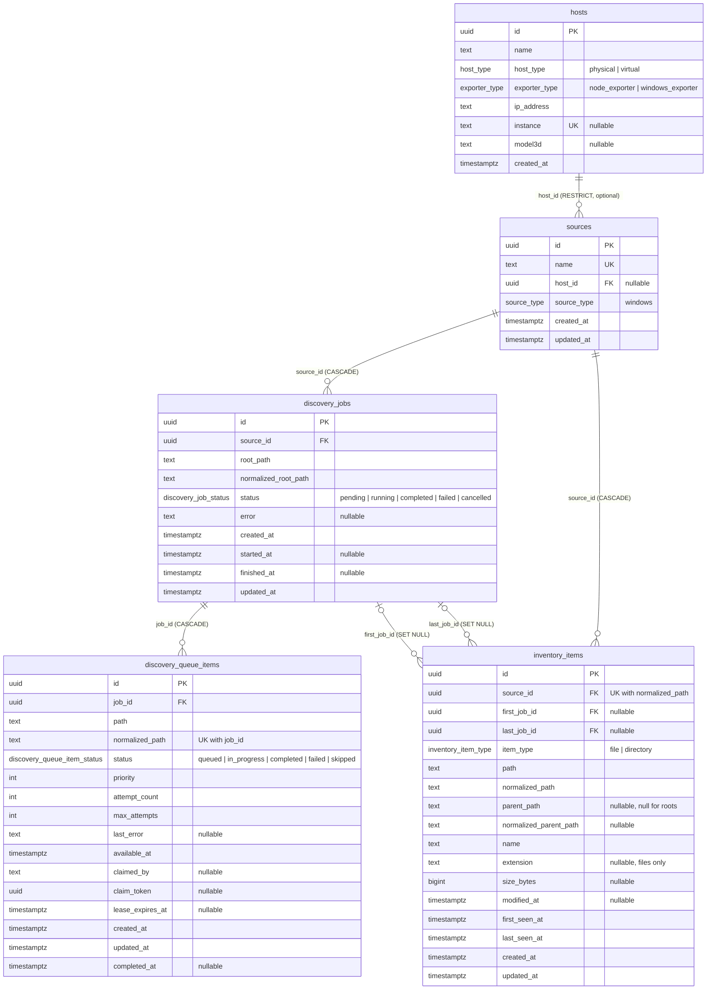

# homelab-db ERD

Entity-relationship diagram for the `homelab_api` database. Source of truth is `src/schema/`; keep this in sync when a migration changes a table.

## Notes

- **Job vs. queue item vs. inventory item.** A job is one run over a source and owns the lifecycle. A queue item is one directory to explore _within_ that job, so it reaches the source only through the job. An inventory item is keyed by source and outlives any single job.
- **Uniqueness.** `discovery_queue_items` is unique on `(job_id, normalized_path)`. `inventory_items` is unique on `(source_id, normalized_path)`. `discovery_jobs` has a partial unique index on `source_id` where status is `pending` or `running`, so a source has at most one active job.
- **State checks (migration `0007`).** `discovery_queue_items`: `0 <= attempt_count <= max_attempts`, and `in_progress` requires `claimed_by`, `claim_token` and `lease_expires_at`. `inventory_items`: `size_bytes >= 0`.
- **Job root.** Creating a job also upserts its root as an `inventory_items` directory, since no worker records the directory it starts from.
- **Normalized paths** are lowercased, so Windows paths compare case-insensitively.
- **Delete behavior.** Deleting a source cascades to its jobs, queue items and inventory. Cancelling or failing a job returns its in-progress queue items to `queued` with the claim cleared. Deleting a job cascades to its queue items but only nulls `first_job_id`/`last_job_id` on inventory. Deleting a host that a source references is blocked (`RESTRICT`).
